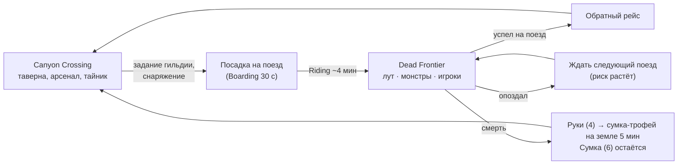

# PE Дизайн 00 — Видение и игровой цикл

> [!abstract] Одной строкой
> **PANDEMIC EXPRESS** — вестерн-хоррор **экстракшн-шутер PvPvE**. Безопасный город Canyon Crossing → поезд на заражённый Dead Frontier → лут, монстры, задания гильдии, другие игроки → успей на поезд обратно. Умер — теряешь то, что было в руках; сумка остаётся.

Решения приняты пользователем 2026-11-09 (сессия планирования). Хаб проекта: [[PE 00 - Обзор]] · план работ: [[PE_Goals_00_Roadmap]] (Фаза 2, G8–G13).

## Столпы
1. **Рейд и возвращение** — поезд по расписанию это и транспорт, и таймер экстракции → [[PE Дизайн 01 — Рейд и поезд-экстракция]]
2. **Риск потери** — 4 предмета в руках теряются при смерти, 6 в сумке сохраняются → [[PE Дизайн 02 — Инвентарь, смерть и сохранение]]
3. **PvPvE с совестью** — в городе за удар по игроку — «вина», в зданиях — вина ×10 (с 2026-11-22), на фронтире — свободно → [[PE Дизайн 03 — PvP, безопасные зоны и вина]]
4. **Путь гильдии** — таверна, задания по одной линии, ранги (Серебро = личный тайник) → [[PE Дизайн 04 — Гильдия и таверна]]
5. **Монстры** — зомби лишь первый из многих; заражение не распространяется → [[PE Дизайн 05 — Монстры]]
6. **Экономика и прогресс** → [[PE Дизайн 06 — Экономика и прогресс]]

Открытые вопросы: [[PE Дизайн 99 — Открытые вопросы]].

## Игровой цикл (одна сессия)

## Что уже есть в плейсе (на 2026-11-09)
| Система | Где | Роль в новом цикле |
|---|---|---|
| Поезд по расписанию | `ServerScriptService.TrainService`, `ReplicatedStorage.TrainShared/TrainState` | таймер рейда и единственный выход ([[PE 15 - Поезд]]) |
| Лут | `LootService`, 87 `LootSpawn` (Tier/Location) | добыча на фронтире |
| Зомби + награды | `ZombieSpawner`, `ZombieBrain`, `KillTracker` (атрибут `Bounty`) | PvE-угроза, деньги ([[PE 12 - Зомби]]) |
| Открытия | `DiscoveryService` (+$25) | задания «разведка» ([[PE 16 - Discovery]]) |
| Арсенал и цены | `ArmoryCatalog`, `Economy.buy`, `ArmoryService` | траты ([[PE 14 - Арсенал]]) |
| Сохранение | `PlayerData` (DataStore `PE_PlayerData_v1`: Cash/Kills/Owned) | расширить: сумка, ранг, задания ([[PE 17 - Деньги]]) |
| Руки + сумка | `ServerStorage.BagUtil`, `BagService`, `BagClient` (4 + 6) | основа правила смерти |
| Карманные часы | `ServerStorage.PocketWatch` | время до поезда (идея: показывать отправление) |
| Зоны | `ReplicatedStorage.Zones` (Priority, Subtitle) | границы безопасных зон / города |
