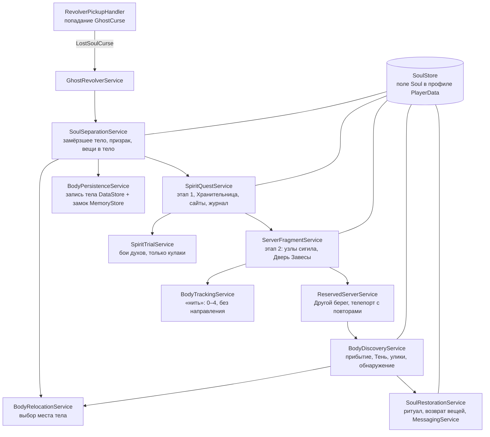

# PE Дизайн 08 — Потерянная душа (The Lost Soul)

Связано: [[PE_Goals_80_Phase5_Wishes|G42]] · [[PE Отчёт 2026-11-21 — Потерянная душа]] · [[PE Дизайн 02 — Инвентарь, смерть и сохранение]] · [[PE Дизайн 03 — PvP, безопасные зоны и вина]] · [[PE Ghost references]]

Сверхъестественный квест «вернуть своё тело»: **Ghost Curse Revolver** отрезает душу игрока, тело уносится на «Другой берег» (собственный Reserved Server души), игрок становится призраком и за **два обязательных этапа** (не меньше ~2 суток реального времени) заслуживает право найти тело, находит сигил своего сервера, переходит туда, находит тело по уликам и проводит ритуал.

## Решения пользователя (2026-11-21)
- Модель револьвера — **GhostCurseRevolver** (его меш `79401392` / текстура `181385568`).
- Револьвер **только у владельца** (UserId 2720869377): бесплатно, виден в оружейной **только ему**, никому больше.
- Длительность — **без ограничений, весь квест минимум 2 дня реального времени**.
- Стиль призрака — бирюзовые светящиеся полупрозрачные фигуры ([[PE Ghost references]]).

## Архитектура (кто кого вызывает)

- Все модули — `ServerStorage.LostSoul.*`, запуск `ServerScriptService.LostSoulMain` (модули получают друг друга через `ctx`). Общие тексты/настройки — `ReplicatedStorage.LostSoul.SoulConfig` (секретов там нет).
- Клиент: `StarterPlayerScripts.LostSoulClient` + `ReplicatedStorage.LostSoul.ClientUI / SpiritSites / Cinematics`. Один RemoteEvent `ReplicatedStorage.LostSoul.LostSoulRemote`.

## Хранение (правило «одно тело — одна запись»)
| Что | Где | Зачем |
|---|---|---|
| SoulID (GUID навсегда), состояние призрака, прогресс этапов, **вещи, ушедшие с телом** | профиль `PE_PlayerData_v2`, поле `Soul` (SoulStore, по образцу StashStore) | одна запись с Bag/Hand — вещи и пустая сумка сохраняются **атомарно**: ни дюпа, ни потери |
| запись тела: n проклятия, место, точка, состояние, **код доступа сервера** | DataStore `PE_SoulBodies_v1`, ключ `body_<SoulID>` | единственная авторитетная запись; код не уходит на клиент |
| обратная карта сервера | DataStore `PE_SoulRealms_v1`, `ps_<PrivateServerId>` → SoulID, UserId | сервер-берег узнаёт, чей он |
| замок тела | MemoryStore `PE_SoulBodyLocks` (TTL 150 с, продление) | тело не появится дважды |
| новость «душа вернулась» | MessagingService `PE_LostSoul` | стрелок узнаёт на любом сервере |

## Этап 1 — «The Unbound» (заслужить право искать)
Четыре обязательные ветки, всё — метки времени (идёт и офлайн):
1. **Забытые воспоминания** — 4 шт., каждое всплывает через **5 ч** после найденного предыдущего (в журнале — «всплыло у <локация>»).
2. **Затерянный язык** — 5 символов на разных локациях; каждый переписанный расшифровывается **2 ч**, по одному.
3. **Испытания духов** — 3 боя (Hollow Warden; две Тени; Warden + две Тени), **ночью**, **только кулаки**, отдых **6 ч** между ними; испытание i открывается воспоминанием i.
4. **Хранительница душ** (Hollow Saint, с фонарём) — сначала отказывает; после трёх веток даёт задания: **бдение** на месте, где душу отрезали (ночью, 3 реальные минуты не сходя с метки), **3 могильные свечи**, **терпение 8 ч**. Этап не кончается раньше **30 ч** от проклятия.
Финал: кинематика у фонаря, открывается «нить» (BodyTrackingService), начинается этап 2. Место и сервер тела **не раскрываются**.

## Этап 2 — «The Tether» (найти сервер тела)
- У каждой души свой **сигил из 4 знаков** (алфавит `ACEFHJKLMNPRTVWXY3479`), создаётся сервером.
- 4 узла находятся **в перемешанном порядке**, каждый своим способом: **Эхо** (метка выстрела, ночью), **Загадка Хранительницы** (ответы с одноразовыми непрозрачными id, ошибка = 20 мин), **Закопанный узел** (только по «нити»: 0–4, никаких направлений; узел проявляется в 10 студах), **Собиратель** (ночной бой).
- Позиция знака в сигиле ≠ порядок находки: каждый узел говорит «это N-й узел нити».
- Следующий узел просыпается через **6 ч** после предыдущего; Дверь Завесы открывается ночью, когда все узлы найдены и прошло **24 ч** этапа. Игрок «произносит» сигил — **сервер** сверяет со своей копией; ошибка = 30 с тишины.
- Успех → этап 3, `ReservedServerService.travel`: сохранение профиля → `TeleportAsync` с `ReservedServerAccessCode`, повторы (3 попытки + `TeleportInitFailed`). Провал телепорта ничего не теряет — Дверь «помнит» душу.

## Другой берег, тело, ритуал
- Сервер-берег пускает только владельца (остальных отправляет в публичный), заново проверяет **всё** (призрак, этап 1, все узлы, переход, нужная душа).
- Тело — вид самого игрока, лежит на спине в одной из 7 мест пула (салун Gravesend, Widow's Mine, церковь Hollow Saint, Rotting Acres, хижина Bloodwood Mill, станция Crow Creek, подвал Blackthorn Estate), в точке LootSpawn (все проверены на достижимость в G22).
- Улики: волочёный след + следы ног, холодные искры на следу, светящиеся отпечатки ладоней на стене, сломанный стул/доски/разбитый фонарь, шёпот и цепь у тела, «искажённое воспоминание» при подходе (75 студов), Блуждающая Тень у депо говорит загадку о месте. **Без маркера.**
- Обнаружение = ≤24 студов + прямая видимость → кинематика + промпт «Return to your body» (3 с).
- Ритуал: призрак притягивается к телу, нити света, вспышка → обычный вид, вещи в руки/сумку/пояс, состояние Living + история, тело и улики удалены (замок снят), запись тела `Restored`, MessagingService, через 14 с — в публичный сервер.

## Правила призрака
- Живые не ранят призрака, призрак не ранит живых (PvPRules); монстры и бандиты призраков не видят; лут, могилы, оружейная, тайник, телеграф — недоступны.
- В руках только кулаки и часы; любой другой предмет, попавший к призраку, «ложится с телом» (до 4 в руку + 6 в сумку).
- Смерть призрака (от духов) — без могилы, собирается рядом с Хранительницей.
- Живые видят призрака как слабое мерцание; чужих духов не видно вовсе.
- Призрак после перезахода остаётся призраком (Soul в профиле).
- **4 формы призрака** (2026-11-21): чем ближе к концу квеста, тем человечнее — 1 Unbound (этап 1, < половины шагов), 2 Fading (≥ половины), 3 Remembering (этап 2), 4 Almost whole (этап 3+) — [[PE Отчёт 2026-11-21 — Четыре формы призрака]].
- **Призрачные скины** (2026-11-21): после настоящего ритуала в конце квеста 4 формы открываются в оружейной (CUSTOMIZE → GHOST SKIN) как чисто визуальный скин — [[PE Отчёт 2026-11-21 — Анимации призрака и призрачные скины]].
- **Самопроклятие владельца (H, 2026-11-21)** — владелец с Ghost Curse в руке жмёт H: выстрел в себя и полное отделение души, как у жертвы (тело, вещи с телом, квест). H призраком — только владельцу — сразу назад, на месте ([[PE Отчёт 2026-11-21 — Ghost Curse, звуки, выстрел и призрачная форма]]).

## Тесты и отладка
`ServerStorage.SoulDebug:Invoke(cmd, …)`: `curse`, `state`, `sites`, `fast <делитель>` (3600 = час за секунду), `night`, `skip`, `interact/talk/choose/veil`, `tp <site|keeper|body|hidden>`, `give <memories|glyphs|trials|tasks|stage1|knots|portal>`, `restore`, `code`. В Studio хранилища — в памяти, берег симулируется на том же сервере.
