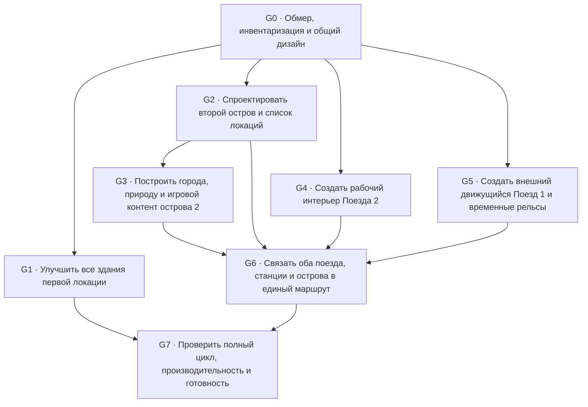
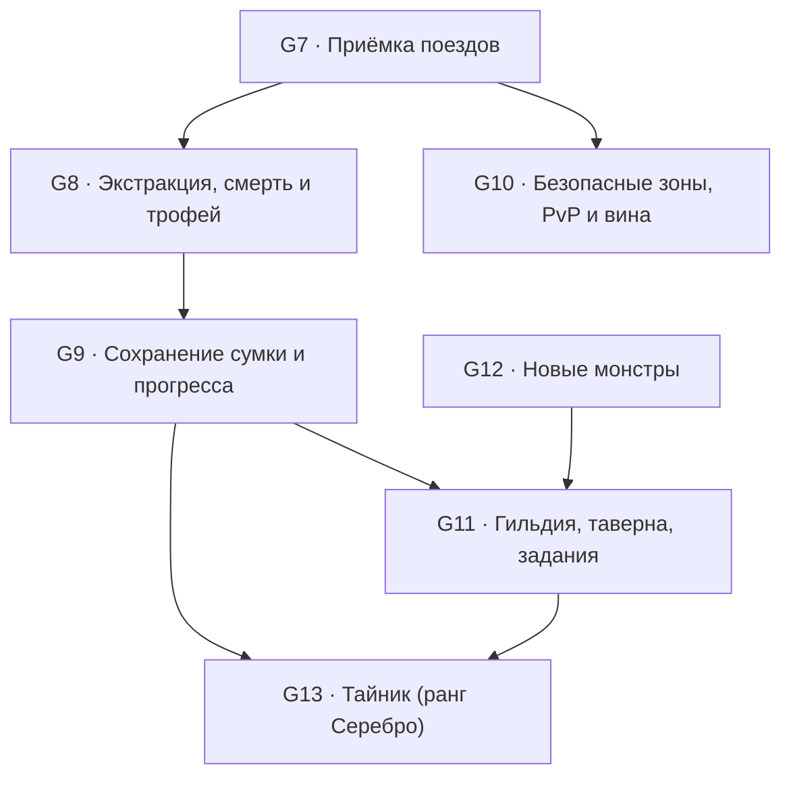
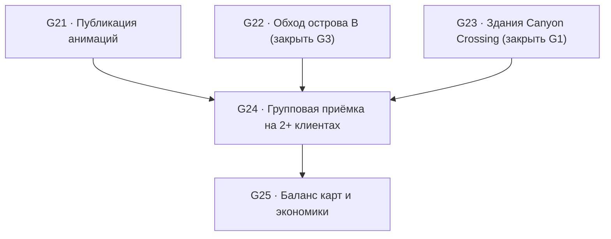

# Граф целей PANDEMIC EXPRESS

> [!abstract] Результат
> Обновить здания первой локации; спроектировать и построить второй остров как целый игровой мир; сделать внешний Поезд 1 с временными рельсами и салон Поезда 2; соединить две зоны рабочим маршрутом туда и обратно.

Связано с картой проекта: `PE 00 - Обзор` · `PE 15 - Поезд` · `PE 21 - Структура карты` · `PE 22 - География зон` · `PE 26 - Очередь аудита`.

## Карта зависимостей

G1 можно вести параллельно проектированию острова. Поезда можно собирать параллельно после утверждения общей высоты, маршрута, станций и состояния поездки. Полная интеграция зависит от острова, двух поездов и маркеров станций.

## Этапы

- [[PE_Goals_01_Baseline_Design|G0 · Базовый обмер и проектирование]] — зафиксировать границы, размеры, критерии качества и маршрут.
- [[PE_Goals_10_FirstIsland_Buildings|G1 · Здания первой локации]] — инвентаризировать и улучшить каждое существующее здание.
- [[PE_Goals_20_SecondIsland_Plan|G2 · План второго острова]] — выбрать биомы, города, точки интереса и порядок прохождения.
- [[PE_Goals_30_SecondIsland_World|G3 · Полноценный игровой остров 2]] — построить города, природу, пути и игровой контент.
- [[PE_Goals_50_Train2_Interior|G4 · Поезд 2 / внутренний салон]] — посадка, сиденья, двери, ожидание и обратная поездка.
- [[PE_Goals_40_Train1_Exterior|G5 · Поезд 1 / внешний состав]] — движущийся по миру поезд на уровне парома, временный путь впереди и уборка за ним.
- [[PE_Goals_60_Transport_Integration|G6 · Транспорт и маршрут целиком]] — связать посадку, поездку, прибытие, возврат и восстановление при сбоях.
- [[PE_Goals_70_Acceptance|G7 · Приёмка и готовность]] — проверить все здания, локации, поездки и критерии качества.

## Что означает «готово» на уровне проекта

1. Каждое здание первой локации есть в реестре и прошло единый визуальный, игровой и технический чек-лист.
2. На втором острове есть законченные города и природные области, связанные проходимым маршрутом; каждая зона имеет точку интереса и игровой смысл.
3. Поезд 1 забирает игроков по заданным точкам, держится на высоте/коридоре, который будет выбран по референсу парома, создаёт сегменты рельс впереди и освобождает сегменты позади.
4. Поезд 2 предоставляет полноценную кабину: игроки входят, занимают места, ждут поездку, прибывают к основной локации, выходят и могут вернуться.
5. Полный путь туда и обратно переживает смерть, выход игрока, опоздавшую посадку и временное отсутствие пассажиров без зависшего персонажа или мусора.
6. Масштаб/число сегментов временного пути ограничены; прибытие и телепортация не оставляют людей застрявшими.

## Решения, которые нужны до крупной сборки

- «Первая локация» трактуется как текущая основная карта/первый остров; подтвердить реальные границы по DataModel.
- ✅ «Основная локация» = станция **CanyonCrossing** (2026-10-28).
- ✅ Высота: уровень платформы `Wraparound PlatformTrain` (верх Y 28.55), вход по ступеням (2026-10-27) — см. [[PE_Goals_15_Train_Route]].
- ✅ Поезд 2 — **отдельная интерьерная сцена**, игроков туда переносят; ~8 проходимых вагонов (2026-10-28).
- ✅ Вместимость 24 (= max игроков, кресла в 1-м вагоне); опоздавшие ждут конца текущего рейса (2026-10-28). Открыто: время ожидания на посадке и правила дверей.

## Состояние

**2026-11-18:** G4, G5, G6 ✅; G7 🟡 (1 игрок проверен, группа нет); G0, G1, G2, G3 🟡 в работе; фаза 2 (G8–G13) ✅; фаза 3 (G14–G20) ✅; **фаза 4 (G21–G25) записана 2026-11-17**, G21 ✅, G22 ✅ 2026-11-18. Отчёты: [[PE Отчёты — журнал]].

## Фаза 2 — игровой процесс (запланировано 2026-11-09)

Дизайн-решения: [[PE Дизайн 00 — Видение и игровой цикл]] (экстракшн PvPvE, гильдия, сумка сохраняется, руки теряются). Все цели G8–G13 сделаны (2026-11-09…13).

| Цель | Что сделать | Дизайн |
|---|---|---|
| **G8** Экстракция и смерть | поезд = единственный выход; руки (4) при смерти → трофей на 5 мин, сумка (6) остаётся. ✅ **смерть/могила/выход в рейде сделаны 2026-11-09** ([[PE Отчёт 2026-11-09 — G8, могила и правило смерти]]) | [[PE Дизайн 01 — Рейд и поезд-экстракция]], [[PE Дизайн 02 — Инвентарь, смерть и сохранение]] |
| **G9** Сохранение | DataStore v2: деньги, револьверы, сумка, ранг, задания; антидюп. ✅ **v2 сделан 2026-11-09** (сумка, места, миграция, блокировка сессии; ранг/задания добавятся с G11) — [[PE Отчёт 2026-11-09 — G9, сохранение сумки и прогресса]] | [[PE Дизайн 02 — Инвентарь, смерть и сохранение]], [[PE Дизайн 06 — Экономика и прогресс]] |
| **G10** PvP и вина | здания безопасны; в городе урон → дебафф на следующий рейд (туман, замедление 2–3 %, фразы при убийстве). ✅ **сделано 2026-11-09** (бой 2 игроков не проверен) — [[PE Отчёт 2026-11-09 — G10, PvP, безопасные здания и вина]] | [[PE Дизайн 03 — PvP, безопасные зоны и вина]] |
| **G11** Гильдия | таверна, линейная цепочка заданий, ранги (охота, вывоз, разведка, оборона). 🟡 **здание таверны построено 2026-11-09** ([[PE Отчёт 2026-11-09 — G11, здание гильдии-таверны]]), 4 этажа 2026-11-10; ✅ **NPC, контракты, ранги, листовки + трек шерифа сделаны 2026-11-10/11** — [[PE 28 - Прогрессия (гильдия и шериф)]], [[PE Отчёт 2026-11-10–11 — Прогрессия, гильдия и шериф]] | [[PE Дизайн 04 — Гильдия и таверна]] |
| **G12** Монстры | новые типы помимо зомби, без распространения заражения. ✅ **оборотни 2026-11-09** ([[PE Отчёт 2026-11-09 — G12, оборотни]]); **вампир, чупакабры, скинвокер + бандиты с главарями 2026-11-11** ([[PE 31 - Монстры]], [[PE 32 - Бандиты]], [[PE Отчёт 2026-11-11 — Толчок, уворот, ружья, монстры, бандиты]]). Тем же заходом вне карты: толчок/уворот ([[PE 29 - Боевые приёмы (толчок и уворот)]]), длинные ружья ([[PE 30 - Длинные ружья]]) | [[PE Дизайн 05 — Монстры]] |
| **G13** Тайник | хранилище в городе, открывается с рангом Серебро | ✅ 2026-11-13: Серебро 8 / Золото 16 слотов, аренда $300, только в хранилище гильдии — [[PE Отчёт 2026-11-13 — G13, тайник гильдии]] · [[PE Дизайн 02 — Инвентарь, смерть и сохранение]] |

Открытые вопросы фазы 2: [[PE Дизайн 99 — Открытые вопросы]].

## Фаза 3 — дополнения (план утверждён 2026-11-09)

Пользователь выбрал 7 дополнений сверх плана. Решения: патроны = пояс без слотов; скупщик в CC 100 %, в Gravesend ~50 %; награду за WANTED платит гильдия ($150, +$100 за каждое следующее убийство, максимум $500); отряд до 4.

| Цель | Что | Статус |
|---|---|---|
| **G14** Гудок + часы | гудок за 60/15/0 с, часы показывают время до поезда | ✅ [[PE Отчёт 2026-11-09 — G14, гудок поезда и часы]] |
| **G15** Атмосфера | волки, ветер, колокол в полночь, шёпот у могил, туман ночью | ✅ `AmbienceClient` + `VenueAmbience` (собрано 2026-11-11, проверено 2026-11-12) — [[PE Отчёт 2026-11-12 — G15, атмосфера и короче уворот]] |
| **G16** Патроны и припасы | пояс патронов (перезарядка тратит), бинты/виски, лут предметами, магазин | ✅ 2026-11-12 (покупка на сервере и патроны из тайника вживую не проверены) — [[PE Отчёт 2026-11-12 — G16, патронташ и припасы]] |
| **G17** Ценности + скупщики | лут = ценности в руках/сумке, Contrabandist (CC) и скупщик в Gravesend | ✅ 2026-11-12 (CC 100 %, Assayer в Gravesend 50 %) — [[PE Отчёт 2026-11-12 — G17, ценности и скупщики]] |
| **G18** Отряд (posse) | до 4, без урона между своими, метки на компасе, общий поезд | ✅ 2026-11-13 (1 игрок + двойники; 2 клиента не проверены) — [[PE Отчёт 2026-11-13 — G18, отряд]] |
| **G19** Награда за убийцу | WANTED на доске контрактов, награда гильдии за убийство | ✅ 2026-11-13 (контракт с плаката: гильдия 50 % $ + 50 % опыт, шериф опыт + $ убийцы; 2 клиента не проверены) — [[PE Отчёт 2026-11-13 — G19, розыск убийц]] |
| **G20** События фронтира | кровавая луна, пыльная буря, разбитый фургон с припасами | ✅ 2026-11-17 (луна ночью 35 %, буря 4 мин, фургон 6 мин раз в 20–30 мин; 2 клиента не проверены) — [[PE Отчёт 2026-11-17 — G20, события фронтира]] |

## Фаза 4 — новые цели (записаны 2026-11-17)

Фаза 3 закрыта 2026-11-17 (G20). Вне плана в тот же день: [[PE Отчёт 2026-11-17 — Карты культиста и особые награды]] (карты культиста + 18 наград «???»). Новые цели собраны из того, что осталось открытым, и из того, что «не проверено» в отчётах.

| Цель | Что сделать | Записано | Статус |
|---|---|---|---|
| **G21** Публикация анимаций | Все клипы из `ReplicatedStorage.Animations` (эмоции, доставание револьвера, монстры, 4 новые эмоции пропусков) опубликовать как Animation и прописать id. Сейчас они собираются из KeyframeSequence, а это работает **только в Studio**: в живой игре другие игроки их не увидят | 2026-11-17 | ✅ 2026-11-18: 182 клипа загружены (id + отпечаток на каждом), 6 скриптов переведены на резолвер, проверено в Play с опубликованными id; живой сервер и 2-й игрок — в G24 — [[PE Отчёт 2026-11-18 — G21, публикация анимаций]] |
| **G22** Обход острова B | Пройти все POI Dead Frontier от станции и обратно. Для каждой локации карточка [[PE_Goals_22_Location_Brief|G2.2]]: вход, выход, цель, проходимость, streaming. Дыры в маршрутах исправить → закрыть [[PE_Goals_30_SecondIsland_World|G3]] | 2026-11-17 | ✅ 2026-11-18: 14 локаций от станции и назад, 92/95 тайников подтверждены (3 на вышках — в G24); форт Cinder был закрыт — починен, 9 тайников со «слепых» вторых этажей опущены, настил к хижине в Bayou — [[PE Отчёт 2026-11-18 — G22, обход острова B]] |
| **G23** Здания Canyon Crossing | Каждое здание CC прогнать по чек-листу [[PE_Goals_12_Building_Standard|G1.2]]: вход, интерьер, коллизии, свет ночью. Пустые коробки достроить → закрыть [[PE_Goals_10_FirstIsland_Buildings|G1]] | 2026-11-17 | запланировано |
| **G24** Групповая приёмка | Server & Clients (2+ игрока): поезд вдвоём (G7), PvP и вина (G10), отряд (G18), розыск (G19), события (G20), карты (титулы / контуры / эмоции видны другим) | 2026-11-17 | запланировано |
| **G25** Баланс карт и экономики | Сыграть рейды с каждой из 15 карт: какие сильны, а какие никто не возьмёт. Проверить цены розыгрыша / выкупа, шанс жетона, деньги за убийства с Devil + Chariot. Предложить пользователю правки | 2026-11-17 | запланировано |

## Фаза 5 — пожелания пользователя (G26–G41)

Из записки [[Pandemic express goals 11.14.26]]: 16 целей, порядок и статусы — [[PE_Goals_80_Phase5_Wishes]]. 2026-11-18 пользователь решил пропустить G23–G25 и начать фазу 5 (G26 быстрые правки).

## Отдельная визуальная доска

`PE_Goals.canvas`
