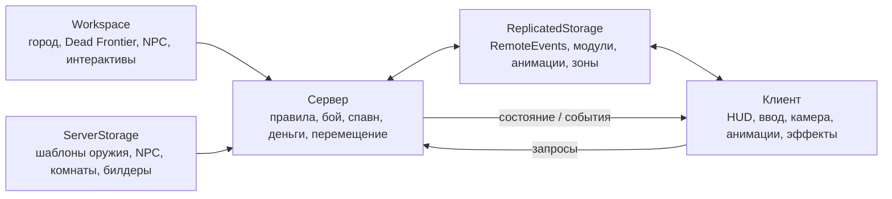

# PANDEMIC EXPRESS — карта плейса для ИИ

> [!abstract] Краткий контекст
> Western survival-хоррор, экстракшн PvPvE: город Canyon Crossing → поезд → рейд на Dead Frontier → поезд обратно. Это рабочая карта проекта, а не документация каждого скрипта.

Графическая карта мира: [[PE Карта мира]].

![[PANDEMIC EXPRESS — схема систем.svg]]

## Снимок и границы анализа

- Источник: открытый Roblox Studio `PANDEMIC EXPRESS (placeId: 76732085725787)`.
- Снимок: 2026-11-22, режим Studio **Edit**, версия 972 + несохранённые правки. Прочитаны иерархия и исходники; поведение в Play для этой карты не проверялось.
- Потомков: `Workspace` 73 282, `ReplicatedStorage` 39 229, `ServerStorage` 63 737.
- `ServerScriptService`: 42 активных `Script`, 3 `ModuleScript`, 1 выключен. `StarterPlayerScripts`: 53 активных `LocalScript`, 2 выключены. Интерфейсы создаются скриптами.

## Архитектура в одном взгляде



### Главные группы данных

| Область | Роль | Точки входа |
|---|---|---|
| `Workspace` | Активный мир: геометрия, NPC, инструменты-подборы и части интерактивов | `Workspace.DeadFrontierMap`, `Workspace.WesternCity`, `Workspace.Saloon`, модели NPC и оружие в мире |
| `ServerScriptService` | Серверные правила и сервисы | `R6Spawn`, `RevolverPickupHandler`, `ArmoryService`, `TravelService`, `ZombieSpawner`, `DiscoveryService` |
| `ReplicatedStorage` | Доступные серверу и клиенту модули, RemoteEvents, анимации и данные зон | `ArmoryCatalog`, `Animations`, `PandemicHUD`, `WesternAtmosphere`, `Zones` |
| `ServerStorage` | Серверные шаблоны и скрытые заготовки | `Revolver`, `Fists`, `ZombieTemplate`, `ArmoryRoom`, `FrontierLocations`, `RevolverSkins` |
| `StarterPlayer.StarterPlayerScripts` | Клиентские контроллеры | `HUD`, `CharacterAnimator`, `MouseControl`, `AtmosphereClient`, `IntroClient`, `ArmoryClient`, `TravelClient` |
| `ReplicatedFirst` | Ранний экран-заставка | `ReplicatedFirst.IntroCover` |

## Все системы (2026-11-22)

| Система | Сервер | Клиент | Модули и данные | Заметки |
|---|---|---|---|---|
| Персонаж, смерть, движение | `R6Spawn`, `DeathAnimations`, `PainService`, `SeatSwivelServer`, `SeatPromptServer`, `CactusDamage` | `CharacterAnimator`, `MouseControl`, `DeathScreen`, `DisableDefaultDeathSound`, `CorpseHands`, `ArmAttachFix`, `SeatLock`, `VaultClient` | `Animations`, `AnimationIdResolver` | [[PE 05 - Персонаж и респавн]], [[PE 06 - Downed и смерть]], [[PE 07 - Анимации]] |
| Оружие и бой | `RevolverPickupHandler`, `DualRevolver`, `HitZones`, `FistsService`, `CombatMovesService`, `LongGunAimService`, `RevolverSpinRelay`, `PickupRespawner` | `StanceMenu`, `CombatMovesClient`, `LongGunPoseClient`, `RevolverSpinClient` | `GunFX`, `LongGun`, `LongGunCore`, `RevolverSpin`, `BoneHitboxes` | [[PE 08 - Револьвер]], [[PE 09 - Dual stance]], [[PE 10 - Fists]], [[PE 11 - Урон и киллы]], [[PE 29 - Боевые приёмы (толчок и уворот)]], [[PE 30 - Длинные ружья]] |
| Враги и NPC | `ZombieSpawner`, `MonsterSpawner`, `BanditDirector`, `NPCAnimator`, `SkinnedMonsterAnimator` | `NPCLife` | `MonsterCore`, `BanditCore`, `MonsterTemplates`, `ZombieTemplate`, `WerewolfTemplate` | [[PE 12 - Зомби]], [[PE 13 - NPC]], [[PE 31 - Монстры]], [[PE 32 - Бандиты]] |
| Поезд и переходы | `TrainService`, `TravelService` | `TrainClient`, `TrainWorld`, `TrainWhistleClient`, `TravelClient` | `TrainShared`, `TrainRoute`, `TrainRouteData`, `Train1Template`, `Train2Scene` | [[PE 15 - Поезд]], [[PE Дизайн 01 — Рейд и поезд-экстракция]] |
| Рейд: вещи и сохранение | `PlayerData`, `BagService`, `BeltService`, `GraveService`, `PocketWatchService`, `StashService` | `BagClient`, `BeltHUD`, `GraveClient`, `StashClient` | `BagUtil`, `ItemRegistry`, `AmmoBelt`, `StashStore` | [[PE 33 - Рейд - сумка, могила, сохранение, вина]], [[PE 23 - Tools и backups]], [[PE Дизайн 02 — Инвентарь, смерть и сохранение]] |
| Экономика и арсенал | `StartingCash`, `Economy`, `LootService`, `FenceService`, `ArmoryService`, `TelegraphService` | `ArmoryClient`, `LootToast`, `FenceClient`, `TelegraphClient` | `ArmoryCatalog`, `ValuableCatalog`, `CustomizationCatalog`, `ParcelStore` | [[PE 14 - Арсенал]], [[PE 17 - Деньги]], [[PE Дизайн 06 — Экономика и прогресс]] |
| Прогрессия и розыск | `ProgressionService`, `BountyService`, `KillTracker` | `ProgressionClient`, `BountyClient`, `TitleClient` | `ProgressionCatalog`, `FlyerDesign`, `BountyCore` | [[PE 28 - Прогрессия (гильдия и шериф)]], [[PE Дизайн 04 — Гильдия и таверна]] |
| PvP, вина, отряд | `GuiltService`, `PosseService` | `GuiltClient`, `GuiltSkull`, `PosseClient` | `PvPRules`, `SafeZones` | [[PE Дизайн 03 — PvP, безопасные зоны и вина]] |
| Карты и Потерянная душа | `CardService`, `LostSoulMain` | `CardClient`, `LostSoulClient`, `GhostCurseClient` | `CardCatalog`, `CardItems`, `LostSoul` | [[PE Дизайн 07 — Карты культиста и особые награды пропусков]], [[PE Дизайн 08 — Потерянная душа]] |
| Мир, время и события | `DayNightCycle`, `EventService`, `DiscoveryService`, `SandstormBorderService` | `AtmosphereClient`, `TimeOfDayKey`, `FrontierEventClient`, `SandstormBorderClient`, `LocationTitles` | `Zones`, `WesternAtmosphere`, `SandstormBorder`, `FrontierLocations` | [[PE 16 - Discovery]], [[PE 18 - День и ночь]], [[PE 21 - Структура карты]], [[PE 22 - География зон]] |
| Звук и окружение | нет | `AmbienceClient`, `FrontierAmbienceClient`, `VenueAmbience`, `DesertEnvironmentAudio`, `RetroFootsteps`, `PlayerJoinSound`, `VisualPolish`, `WindmillSpin`, `SaloonDoors` | `PESounds`, `LocationAmbience` | [[PE 24 - Атмосфера]] |
| Интро и интерфейс | `IntroService` | `IntroClient`, `HUD`, `HudToggle`, `InteractionPromptStyle`, `EmoteWheel` | `PandemicHUD`, `IntroModules` | [[PE 19 - Интро]], [[PE 20 - HUD]], [[PE 34 - Эмоции, колесо B и доставание револьвера]] |

## Основные игровые системы

Как связаны базовые системы.

| Система | Сервер | Клиент / данные | Связь и назначение |
|---|---|---|---|
| Персонаж и смерть | `ServerScriptService.R6Spawn`, `DeathAnimations` | `CharacterAnimator`, `DeathScreen`, `CorpseHands`; `ReplicatedStorage.Animations` | Принудительный R6-спавн, серверное состояние смерти/сброса и набор анимаций; `DownedResetRequest` передаёт серверу запрос сброса. |
| Оружие и стрельба | `RevolverPickupHandler`, `DualRevolver`, `HitZones`; шаблон `ServerStorage.Revolver` | `StanceMenu`, `CharacterAnimator`, скрипты внутри оружия | Сервер выдаёт оружие и обрабатывает попадания/урон; атрибут `Stance` управляет одиночным или парным револьвером. `RevolverShotEffects` сообщает клиентам о визуальных эффектах выстрела. |
| Ближний бой | `FistsService`; шаблон `ServerStorage.Fists` | `ServerStorage.Fists.FistsClient` | Клиент отправляет `PunchRequest`; сервер ищет цель перед игроком и подтверждает попадание через `HitMarker`. |
| Зомби | `ZombieSpawner`; `ServerStorage.ZombieTemplate.Zombie.ZombieBrain` | `NPCAnimator`, `CorpseHands` | Зомби создаются около точек `ZombieSpawn` внутри `Workspace.DeadFrontierMap.CompleteWorld.Locations`; лимит 3 на локацию (6 в кровавую луну), пробуждение — рядом с игроком. |
| Арсенал | `ArmoryService`, `ArmoryCatalog`, `ServerStorage.ArmoryRoom`, `GiveRevolver` | `ArmoryClient`, `ArmoryPreviews`, общий `PandemicHUD.Theme` | Промпт у `ArmoryOwner` открывает личную копию комнаты; клиент выбирает/экипирует предметы, сервер выдаёт их и возвращает игрока. Атрибут `InArmory` сигнализирует другим клиентским системам. |
| Поезд / переход | `TravelService` | `TravelClient` | Атрибут `TravelTo` на `ProximityPrompt` задаёт станцию. Сервер ищет часть с тегом `TravelArrival` и атрибутом `Station`, затем переносит игрока. Есть станции `Gravesend` и `CanyonCrossing`. Рейс по расписанию ведёт `TrainService`. В мире 2 части с тегом `TravelArrival`. |
| Обнаружение мест | `DiscoveryService`, `ReplicatedStorage.Zones` | `HUD`, `LocationTitles` | Клиентская зона задаёт `CurrentZone`; сервер отдельно проверяет вхождение в именованные Parts, добавляет 25 Cash и отправляет `DiscoveryRemote`. Зоны с `Subtitle` дают карточку локации. |
| День / ночь | `DayNightCycle`, `WesternAtmosphere.Config` | `AtmosphereClient`, `TimeOfDayKey`, `WesternAtmosphere.LightController` | Сервер публикует `Workspace`-атрибуты `CycleEpoch`, `TimePhase`, `IsNight`; клиент визуально применяет освещение. Клавиша `0` посылает `CycleTimeRequest`. |
| Интро | `IntroService` | `ReplicatedFirst.IntroCover`, `IntroClient`, `IntroModules` | `IntroEvent` обменивается состоянием первого входа и сигналами Begin/Finished; сервер использует DataStore для запоминания просмотра. |
| Деньги / убийства | `StartingCash`, `KillTracker`, отдельные серверные обработчики | `HUD` | Деньги и убийства отражаются в атрибутах игрока `Cash` и `Kills`; награда за убийство ожидает стандартный `creator` ObjectValue либо внутренний `KillCredit` BindableEvent. |
| Атмосфера / окружение | `DayNightCycle`, `WesternAtmosphere` | `AtmosphereClient`, `DesertEnvironmentAudio`, `RetroFootsteps`, `VisualPolish`, `WindmillSpin` | Отдельные контроллеры отвечают за время суток, звук, шаги и визуальные эффекты. `RetroDayNightCycle` выключен. |

## Мир и локации

### Структура Dead Frontier

```text
Workspace
└── DeadFrontierMap
    ├── LootSpawns
    └── CompleteWorld
        ├── Regions
        ├── Roads, Rails and Bridges
        ├── Frontier Forests
        ├── Frontier Details
        ├── Codex_Frontier_Completion
        └── Locations
```

В `ServerStorage.FrontierLocations` 15 модулей-сборщиков локаций. Спавнеры берут точки из уже построенного мира, а не из этих модулей.

### Именованные зоны

`ReplicatedStorage.Zones` содержит 20 объёмных Parts, используемых для названий и открытия мест:

- HOLLOW SAINT — Where the faithful were buried twice
- WIDOW'S MINE — Shaft No. 3 never stopped digging
- FORT CINDER — The garrison held for one night
- ROTTING ACRES — Nothing grows here but the dead
- DEADMAN'S RAIL — The Pandemic Express never reached the station
- BLOODWOOD MILL — The red trees bleed when you cut them
- BLACKWATER BAYOU — Mind the water. Something minds you.
- BLACKTHORN ESTATE — The family never left
- GRAVESEND DEPOT — Last stop on the Dead Frontier
- CANYON CROSSING — A town at the end of the line
- CANYON CROSSING STATION — зона без Subtitle
- THE DEAD FRONTIER — большая охватывающая зона
- GRAVESEND — Population: nobody you'd want to meet
- DEVIL'S REFINERY — Black gold, black lungs
- QUARANTINE CAMP — No one leaves. No one ever left.
- STILLWATER LANDING — The lake keeps what it takes.
- OUTLAW'S ROOST — Nobody rides up here twice.
- CROW CREEK STATION — The last coach came back on its side.
- THE PANDEMIC EXPRESS — Aboard the train
- FRONTIER GUILD — The Last Lantern. Bounties, contracts and a warm fire.

Координаты, угрозы и картинки: [[PE Карта мира]].

## Сетевые контракты

| Remote / канал | Где объявлен | Использование |
|---|---|---|
| `ReplicatedStorage.DownedResetRequest` | Статически присутствует | Клиент просит сервер обработать сброс/смерть персонажа. |
| `ReplicatedStorage.StanceRequest` | Статически присутствует | Клиент запрашивает смену стойки револьвера. |
| `ReplicatedStorage.ArmoryRemote` | Статически присутствует | Клиентские команды меню арсенала ↔ сервер. |
| `ReplicatedStorage.RevolverShotEffects` | Статически присутствует | Сервер сообщает клиентам о выстреле другого игрока. |
| `ReplicatedStorage.HitMarker` | Статически присутствует | Сервер сообщает атакующему результат попадания. |
| `ReplicatedStorage.SeatSwivel` | Статически присутствует, `UnreliableRemoteEvent` | Непостоянные обновления разворота при сидении. |
| `ReplicatedStorage.WesternAtmosphere.CycleTimeRequest` | Статически присутствует | Клиентская клавиша `0` просит сервер перейти к следующей фазе времени. |
| `ReplicatedStorage.IntroRemotes.IntroEvent` | Создаётся сервером, если отсутствует | Состояние / Begin / Finished для интро. |
| `ReplicatedStorage.TravelRemote` | Создаётся `TravelService` при старте | Сервер управляет карточкой поездки на клиенте. |
| `ReplicatedStorage.DiscoveryRemote` | Создаётся `DiscoveryService` при старте | Сервер передаёт клиенту новую найденную локацию и награду. |
| `ServerStorage.TravelTo` | Создаётся `TravelService` как BindableFunction | Серверный API для переноса игрока из других серверных скриптов. |
| `ServerStorage.GiveRevolver` | Создаётся `RevolverPickupHandler` как BindableFunction | Серверный API выдачи револьвера для арсенала и других систем. |

### Все remotes по системам (2026-11-22)

Часть создаётся сервисами при старте и в Edit не видна. `GunRemote` относится к длинным ружьям.

| Система | Remotes |
|---|---|
| Персонаж, смерть, движение | `DownedResetRequest`, `CorpseDragUnder`, `SeatSwivel` |
| Оружие и бой | `RevolverShotEffects`, `HitMarker`, `StanceRequest`, `CombatMoves`, `LongGunAim`, `RevolverDrawSpin`, `GunRemote` |
| Поезд и переходы | `TrainRemote`, `TravelRemote` |
| Рейд: вещи и сохранение | `BagRemote`, `GraveRemote`, `StashRemote` |
| Экономика и арсенал | `ArmoryRemote`, `LootRemote`, `FenceRemote`, `ParcelRemote` |
| Прогрессия и розыск | `ProgressionRemote`, `BountyRemote` |
| PvP, вина, отряд | `GuiltRemote`, `PosseRemote`, `PossePulse` |
| Карты и Потерянная душа | `CardRemote`, `LostSoulRemote`, `SelfCurseRemote` |
| Мир, время и события | `CycleTimeRequest`, `FrontierEventRemote`, `DiscoveryRemote` |
| Интро и интерфейс | `IntroEvent` |

## Опорные пути для следующего ИИ

1. Начать с `ServerScriptService` и `StarterPlayer.StarterPlayerScripts`; это основные активные точки входа.
2. Для совместного состояния/сигналов читать `ReplicatedStorage` и сопоставлять обе стороны RemoteEvent.
3. Для оружия смотреть одновременно `RevolverPickupHandler`, `ServerStorage.Revolver`, `RevolverSkins`, `RevolverAnimation`, `DualRevolver`, `StanceMenu` и `CharacterAnimator`.
4. Для врагов смотреть `ZombieSpawner`, `MonsterSpawner`, `BanditDirector`, `ServerStorage.ZombieTemplate.Zombie.ZombieBrain`, точки `ZombieSpawn`, `NPCAnimator` и `DeathAnimations`.
5. Для мира начинать с `Workspace.DeadFrontierMap.CompleteWorld` и соответствующих шаблонов в `ServerStorage.FrontierLocations`.
6. Для поезда смотреть `TrainService`, `TrainShared`, `TrainRoute`, `TrainWorld`; для новой поездки проверить `TravelService.STATIONS`, `TravelArrival` tag, атрибуты `Station` и промпт с `TravelTo`.
7. Перед правкой UI проверить `PandemicHUD.Theme`, `HUDLayout` и влияние `HUD` на автоматически создаваемые интерфейсы.

> [!warning] Не считать резервные копии рабочим кодом
> `ServerStorage._AnimBackup` и `ServerStorage._Backups` содержат множество исторических снимков. При поиске логики ориентироваться на активные скрипты, перечисленные выше; резервные копии использовать только для сравнения после явного запроса.

## Что перепроверить в следующем проходе

- Цикл суток: активен `DayNightCycle`; `RetroDayNightCycle` и `DayNightSkipKey` выключены.
- `IntroService` и `PlayerData` зависят от DataStore: проверка в Studio требует доступа к API или тестового режима.
- Workspace содержит больше 70 000 Instances: менять по регионам, не одной операцией.
- После изменений мира или систем обновить [[PE Карта мира]] и схему систем.

## Инструкция для ИИ, который продолжает работу

Сначала прочитай эту заметку и `PANDEMIC EXPRESS — схема систем.svg`. Затем проверь актуальную иерархию и исходники в подключённом Roblox Studio: снимок может устареть. Изменения предлагай по конкретным системам, сохраняй серверную авторитетность для урона/денег/перемещения, проверяй связанные RemoteEvents и не копируй код из `_AnimBackup` как текущую версию. Не публикуй плейс и не меняй не относящиеся к задаче системы.


## Граф Obsidian

Навигация по связанным системным заметкам: [[PE 00 - Обзор]].

> [!note] Снимок выше: 2026-11-22
> Подробности систем описаны в заметках PE 01–34. У каждой своя дата сверки, она может быть старше этой карты.
