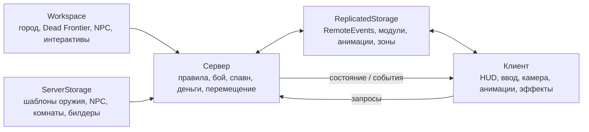

# PANDEMIC EXPRESS — карта плейса для ИИ

> [!abstract] Краткий контекст
> Кооперативный western / survival-хоррор: игроки исследуют город Canyon Crossing и область Dead Frontier, сражаются с NPC и зомби, собирают оружие и могут перемещаться между станциями. Это рабочая карта проекта для дальнейшего изучения, а не исчерпывающая документация каждого скрипта.

![[PANDEMIC EXPRESS — схема систем.svg]]

## Снимок и границы анализа

- Источник: открытый Roblox Studio `PANDEMIC EXPRESS (placeId: 76732085725787)`.
- Снимок: 2026-10-27, режим Studio **Edit**. Игра не запускалась; поведение в рантайме отдельно не проверялось.
- Иерархия содержит около 48 030 потомков в `Workspace`, 13 578 в `ReplicatedStorage` и 33 073 в `ServerStorage`. В `Workspace` 740 прямых детей.
- `ServerScriptService`: 18 серверных `Script` и 2 `ModuleScript`. Основные клиентские контроллеры находятся в `StarterPlayer > StarterPlayerScripts`; стандартная `StarterGui` пуста, интерфейсы создаются скриптами.

## Архитектура в одном взгляде



### Главные группы данных

| Область | Роль | Точки входа |
|---|---|---|
| `Workspace` | Активный мир: геометрия, NPC, инструменты-подборы и части интерактивов | `Workspace.DeadFrontierMap`, `Workspace.WesternCity`, `Workspace.Saloon`, модели NPC и оружие в мире |
| `ServerScriptService` | Серверные правила и сервисы | `R6Spawn`, `RevolverPickupHandler`, `ArmoryService`, `TravelService`, `ZombieSpawner`, `DiscoveryService` |
| `ReplicatedStorage` | Доступные серверу и клиенту модули, RemoteEvents, анимации и данные зон | `ArmoryCatalog`, `Animations`, `PandemicHUD`, `WesternAtmosphere`, `Zones` |
| `ServerStorage` | Серверные шаблоны и скрытые заготовки | `Revolver`, `Fists`, `ZombieTemplate`, `ArmoryRoom`, `FrontierLocations`, `RevolverSkins` |
| `StarterPlayer.StarterPlayerScripts` | Клиентские контроллеры | `HUD`, `CharacterAnimator`, `MouseControl`, `AtmosphereClient`, `IntroClient`, `ArmoryClient`, `TravelClient` |
| `ReplicatedFirst` | Ранний экран-заставка | `ReplicatedFirst.IntroCover` |

## Основные игровые системы

| Система | Сервер | Клиент / данные | Связь и назначение |
|---|---|---|---|
| Персонаж и смерть | `ServerScriptService.R6Spawn`, `DeathAnimations` | `CharacterAnimator`, `DeathScreen`, `CorpseHands`; `ReplicatedStorage.Animations` | Принудительный R6-спавн, серверное состояние смерти/сброса и набор анимаций; `DownedResetRequest` передаёт серверу запрос сброса. |
| Оружие и стрельба | `RevolverPickupHandler`, `DualRevolver`, `HitZones`; шаблон `ServerStorage.Revolver` | `StanceMenu`, `CharacterAnimator`, скрипты внутри оружия | Сервер выдаёт оружие и обрабатывает попадания/урон; атрибут `Stance` управляет одиночным или парным револьвером. `RevolverShotEffects` сообщает клиентам о визуальных эффектах выстрела. |
| Ближний бой | `FistsService`; шаблон `ServerStorage.Fists` | `ServerStorage.Fists.FistsClient` | Клиент отправляет `PunchRequest`; сервер ищет цель перед игроком и подтверждает попадание через `HitMarker`. |
| Зомби | `ZombieSpawner`; `ServerStorage.ZombieTemplate.Zombie.ZombieBrain` | `NPCAnimator`, `CorpseHands` | Зомби создаются около точек `ZombieSpawn` внутри `Workspace.DeadFrontierMap.CompleteWorld.Locations`; лимит — 3 на локацию, пробуждение — рядом с игроком. |
| Арсенал | `ArmoryService`, `ArmoryCatalog`, `ServerStorage.ArmoryRoom`, `GiveRevolver` | `ArmoryClient`, `ArmoryPreviews`, общий `PandemicHUD.Theme` | Промпт у `ArmoryOwner` открывает личную копию комнаты; клиент выбирает/экипирует предметы, сервер выдаёт их и возвращает игрока. Атрибут `InArmory` сигнализирует другим клиентским системам. |
| Поезд / переход | `TravelService` | `TravelClient` | Атрибут `TravelTo` на `ProximityPrompt` задаёт станцию. Сервер ищет часть с тегом `TravelArrival` и атрибутом `Station`, затем переносит игрока. Есть станции `Gravesend` и `CanyonCrossing`. В Studio проверить наличие тегов и атрибутов у частей `TravelArrival_*`. |
| Обнаружение мест | `DiscoveryService`, `ReplicatedStorage.Zones` | `HUD`, `LocationTitles` | Клиентская зона задаёт `CurrentZone`; сервер отдельно проверяет вхождение в именованные Parts, добавляет 25 Cash и отправляет `DiscoveryRemote`. Зоны с `Subtitle` дают карточку локации. |
| День / ночь | `DayNightCycle`, `WesternAtmosphere.Config` | `AtmosphereClient`, `TimeOfDayKey`, `WesternAtmosphere.LightController` | Сервер публикует `Workspace`-атрибуты `CycleEpoch`, `TimePhase`, `IsNight`; клиент визуально применяет освещение. Клавиша `0` посылает `CycleTimeRequest`. |
| Интро | `IntroService` | `ReplicatedFirst.IntroCover`, `IntroClient`, `IntroModules` | `IntroEvent` обменивается состоянием первого входа и сигналами Begin/Finished; сервер использует DataStore для запоминания просмотра. |
| Деньги / убийства | `StartingCash`, `KillTracker`, отдельные серверные обработчики | `HUD` | Деньги и убийства отражаются в атрибутах игрока `Cash` и `Kills`; награда за убийство ожидает стандартный `creator` ObjectValue либо внутренний `KillCredit` BindableEvent. |
| Атмосфера / окружение | `RetroDayNightCycle`, `DayNightCycle`, `WesternAtmosphere` | `AtmosphereClient`, `DesertEnvironmentAudio`, `RetroFootsteps`, `VisualPolish`, `WindmillSpin` | Отдельные контроллеры отвечают за время суток, звук, шаги и визуальные эффекты. До правок цикла времени проверь, какие из двух серверных циклов должны быть активны. |

## Мир и локации

### Структура Dead Frontier

```text
Workspace
└── DeadFrontierMap
    ├── LootSpawns
    └── CompleteWorld
        ├── Regions
        ├── Roads, Rails and Bridges
        ├── Frontier Forests
        ├── Frontier Details
        ├── Codex_Frontier_Completion
        └── Locations
```

В `ServerStorage.FrontierLocations` находятся 10 модулей-заготовок: `HollowSaint`, `WidowsMine`, `FortCinder`, `RottingAcres`, `DeadmansRail`, `BloodwoodMill`, `BlackwaterBayou`, `BlackthornEstate`, `GravesendDepot`, `GravesendBackLots`. `ZombieSpawner` берёт точки спавна из уже построенного мира, а не клонирует эти модули напрямую.

### Именованные зоны

`ReplicatedStorage.Zones` содержит 14 объёмных Parts, используемых для названий и открытия мест:

- HOLLOW SAINT — Where the faithful were buried twice
- WIDOW'S MINE — Shaft No. 3 never stopped digging
- FORT CINDER — The garrison held for one night
- ROTTING ACRES — Nothing grows here but the dead
- DEADMAN'S RAIL — The Pandemic Express never reached the station
- BLOODWOOD MILL — The red trees bleed when you cut them
- BLACKWATER BAYOU — Mind the water. Something minds you.
- BLACKTHORN ESTATE — The family never left
- GRAVESEND DEPOT — Last stop on the Dead Frontier
- CANYON CROSSING — A town at the end of the line
- CANYON CROSSING STATION — зона без Subtitle
- THE DEAD FRONTIER — большая охватывающая зона
- GRAVESEND — Population: nobody you'd want to meet
- DEVIL'S REFINERY — Black gold, black lungs

## Сетевые контракты

| Remote / канал | Где объявлен | Использование |
|---|---|---|
| `ReplicatedStorage.DownedResetRequest` | Статически присутствует | Клиент просит сервер обработать сброс/смерть персонажа. |
| `ReplicatedStorage.StanceRequest` | Статически присутствует | Клиент запрашивает смену стойки револьвера. |
| `ReplicatedStorage.ArmoryRemote` | Статически присутствует | Клиентские команды меню арсенала ↔ сервер. |
| `ReplicatedStorage.RevolverShotEffects` | Статически присутствует | Сервер сообщает клиентам о выстреле другого игрока. |
| `ReplicatedStorage.HitMarker` | Статически присутствует | Сервер сообщает атакующему результат попадания. |
| `ReplicatedStorage.SeatSwivel` | Статически присутствует, `UnreliableRemoteEvent` | Непостоянные обновления разворота при сидении. |
| `ReplicatedStorage.WesternAtmosphere.CycleTimeRequest` | Статически присутствует | Клиентская клавиша `0` просит сервер перейти к следующей фазе времени. |
| `ReplicatedStorage.IntroRemotes.IntroEvent` | Создаётся сервером, если отсутствует | Состояние / Begin / Finished для интро. |
| `ReplicatedStorage.TravelRemote` | Создаётся `TravelService` при старте | Сервер управляет карточкой поездки на клиенте. |
| `ReplicatedStorage.DiscoveryRemote` | Создаётся `DiscoveryService` при старте | Сервер передаёт клиенту новую найденную локацию и награду. |
| `ServerStorage.TravelTo` | Создаётся `TravelService` как BindableFunction | Серверный API для переноса игрока из других серверных скриптов. |
| `ServerStorage.GiveRevolver` | Создаётся `RevolverPickupHandler` как BindableFunction | Серверный API выдачи револьвера для арсенала и других систем. |

## Опорные пути для следующего ИИ

1. Начать с `ServerScriptService` и `StarterPlayer.StarterPlayerScripts`; это основные активные точки входа.
2. Для совместного состояния/сигналов читать `ReplicatedStorage` и сопоставлять обе стороны RemoteEvent.
3. Для оружия смотреть одновременно `RevolverPickupHandler`, `ServerStorage.Revolver`, `RevolverSkins`, `RevolverAnimation`, `DualRevolver`, `StanceMenu` и `CharacterAnimator`.
4. Для врагов смотреть `ZombieSpawner`, `ServerStorage.ZombieTemplate.Zombie.ZombieBrain`, точки `ZombieSpawn`, `NPCAnimator` и `DeathAnimations`.
5. Для мира начинать с `Workspace.DeadFrontierMap.CompleteWorld` и соответствующих шаблонов в `ServerStorage.FrontierLocations`.
6. Для новой поездки проверить `TravelService.STATIONS`, `TravelArrival` tag, атрибуты `Station` и промпт с `TravelTo`.
7. Перед правкой UI проверить `PandemicHUD.Theme`, `HUDLayout` и влияние `HUD` на автоматически создаваемые интерфейсы.

> [!warning] Не считать резервные копии рабочим кодом
> `ServerStorage._AnimBackup` и `ServerStorage._Backups` содержат множество исторических снимков. При поиске логики ориентироваться на активные скрипты, перечисленные выше; резервные копии использовать только для сравнения после явного запроса.

## Что перепроверить в следующем проходе

- В `ServerScriptService` одновременно присутствуют `DayNightCycle` и `RetroDayNightCycle`, а в клиенте — `TimeOfDayKey` и `DayNightSkipKey`. Оба набора выглядят активными в DataModel; прежде чем менять цикл, проверить их реальные записи в `Lighting`, атрибуты и намерение автора.
- Перемещение поезда требует CollectionService-тег `TravelArrival` и атрибут `Station`. Названия `TravelArrival_*` сами по себе не подтверждают, что эти маркеры настроены.
- `IntroService` использует DataStore; проверка первого входа в Studio зависит от включённого доступа к API и настройки тестового режима.
- Большая часть визуальной карты — десятки тысяч Instances. Изменения группировать по узлам/регионам, не перестраивать весь Workspace одной операцией.

## Инструкция для ИИ, который продолжает работу

Сначала прочитай эту заметку и `PANDEMIC EXPRESS — схема систем.svg`. Затем проверь актуальную иерархию и исходники в подключённом Roblox Studio: снимок может устареть. Изменения предлагай по конкретным системам, сохраняй серверную авторитетность для урона/денег/перемещения, проверяй связанные RemoteEvents и не копируй код из `_AnimBackup` как текущую версию. Не публикуй плейс и не меняй не относящиеся к задаче системы.


## Граф Obsidian

Навигация по связанным системным заметкам: [[PE 00 - Обзор]].

> [!note] Снимок выше — 2026-10-27
> Системы, добавленные позже, описаны в отдельных заметках (сверены с плейсом 2026-11-12): [[PE 28 - Прогрессия (гильдия и шериф)]], [[PE 29 - Боевые приёмы (толчок и уворот)]], [[PE 30 - Длинные ружья]], [[PE 31 - Монстры]], [[PE 32 - Бандиты]], [[PE 33 - Рейд - сумка, могила, сохранение, вина]], [[PE 34 - Эмоции, колесо B и доставание револьвера]]. Поезд по расписанию — [[PE 15 - Поезд]] и отчёты 2026-11-08.
