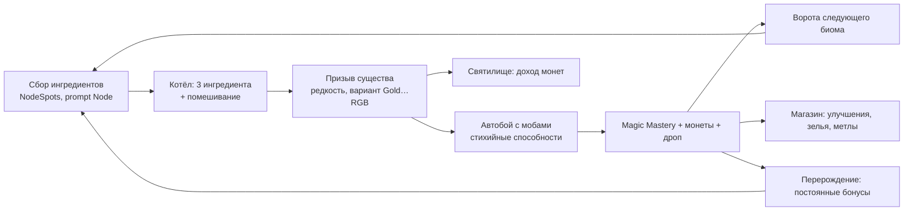
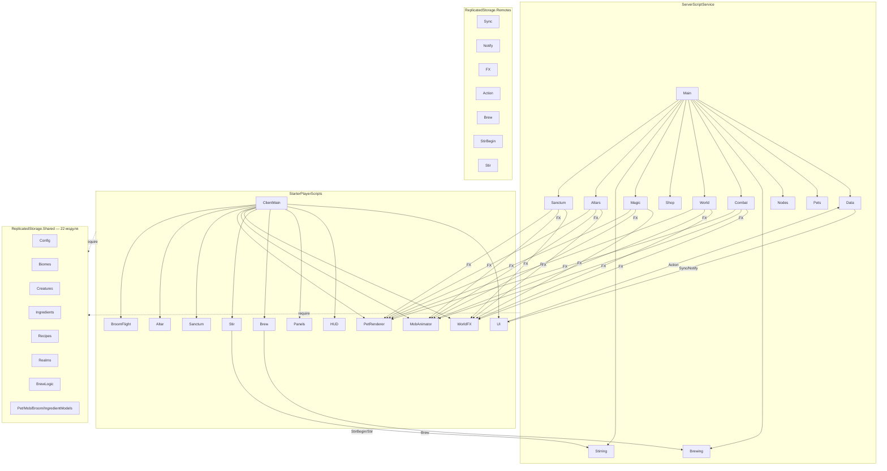

# Use magick for Animals — обзор плейса

Карта: [[MA 01 - Карта плейса]] (по заметке на каждый скрипт, ремоут, место и биом) · звуки: [[MA 02 - Звуки]]

Roblox-плейс **Use magick for Animals** (placeId 86849860762466, universe 10777115578, версия 87, имя DataModel `Place1`). Анализ 2026-11-19 в режиме Edit, без изменений в плейсе. В коде профиль хранится как `AlchemyProfiles_v1`.

![[2026-11-19_мир_сверху.jpg]]

## Что это за игра
Волшебный симулятор алхимика-приручителя: игрок собирает ингредиенты в биомах, варит их по три в котле, призывает существо-питомца, питомцы сами дерутся с мобами, а Magic Mastery открывает ворота в следующий биом. Существ можно ставить в личное **Святилище**, где они приносят монеты (и офлайн). Сверху — метлы, перерождения, квесты, ежедневки, алтари с мини-игрой «Tap the Rune».

## Цифры
| | |
|---|---|
| Биомы | 30 в линию по −Z (шаг 448 студов), Mastery 1 → 91, у каждого 2 стихии (первые 3 — базовые) |
| Существа | 310: Common 61 · Uncommon 62 · Rare 34 · Epic 59 · Legendary 32 · Mythical 31 · Secret 31 |
| Ингредиенты | 180 (6 на биом) |
| Мобы | 90 (по 3 на биом, один из них босс) |
| Рецепты / книги | 62 секретных рецепта, 63 древние книги |
| Метлы | 12 (Apprentice Broom … Voidheart Scepter), 6 улучшений |
| Квесты | 17 вех (First Harvest … Archmage) |
| Улучшения / зелья | 6 постоянных, 4 зелья по 5 мин (кап 30 мин) |
| Мир | 55 612 деталей в `Workspace.World`, StreamingEnabled, MaxPlayers 60 |
| Код | 55 активных скриптов: сервер 12, общие 22, клиент 21 (+3 билдера в ServerStorage) |

![[MA карта мира.svg]]

## Архитектура

- **Сервер авторитетен.** Все действия игрока идут через один `Remotes.Action` (RemoteFunction) → таблица `Data.Actions`, которую заполняют сервисы (24 действия: Pets, Shop, Magic, World, Altars, Sanctum). Лимит: 0.03 с между любыми запросами, 0.12 с между одинаковыми, обработчик в `pcall`.
- **Данные:** `Data` — DataStore `AlchemyProfiles_v1` с session lock (`_lock = {job, t}`, TTL 300 с, автосейв раз в 2 мин, `BindToClose` ждёт до 25 с), `_v` = версия схемы 1.
- **Клиент** строит весь UI кодом (StarterGui пуст): один ScreenGui из `Client.UI`, профиль приходит через `Sync`.
- **Мобы** — физические тела, которые двигает сервер; модели и анимации делает клиент (`MobAnimator`, `MobModelsHQ`). Питомцы рисуются только на клиенте (`PetRenderer`).
- **Мир** строится в Edit билдером `ServerStorage.WorldBuilder` (хаб + 30 биомов); старая раскладка островами лежит в `ServerStorage.World_OldIslands`.
- В Studio `Main` создаёт `ServerStorage.Debug` (BindableFunction: profile / ingredient / xp / coins / creature / potion / set) — в живом сервере его нет.

## Хаб
![[2026-11-19_хаб_и_лес.jpg]]
Спавн (0, 0, 44), портал путешествий, лекторны, лавка зелий, 2 алтаря (±46, −46), 5 Святилищ в садах за спавном и 5 сцен `Stage`. Подробно — заметки кластера **Локации** на [[MA 01 - Карта плейса]].

## Риски и вопросы
1. **5 Святилищ на сервер при MaxPlayers 60.** Шестой и дальше игрок попадает в очередь (`SanctumQueue`) и остаётся без базы, пока кто-то не выйдет. Нужно либо MaxPlayers ≈ 5–6, либо больше участков.
2. **Вредоносного кода не найдено:** нет `require(<число>)`, `getfenv`, `loadstring`, `PostAsync` ни в одном скрипте. Бесплатная модель AndrewGraves удалена 2026-11-19 (её Documentation лежит отключённой в `_VisualBackup`).
3. **ServerStorage тяжёлый:** `_VisualBackup` (≈90 копий скриптов, 7861 объект), `World_OldIslands` (2857), `SanctumStages` (5035). Для работы мешает только поиском — активные пути см. на карте.
4. **Огромные числа к концу:** HP мобов в поздних биомах — миллионы (например Horned Charger в Amber Savanna — 2 244 608 HP), баланс стоит проверить плейтестом.
5. В Studio не проверялось в Play — это статический анализ кода и DataModel.
