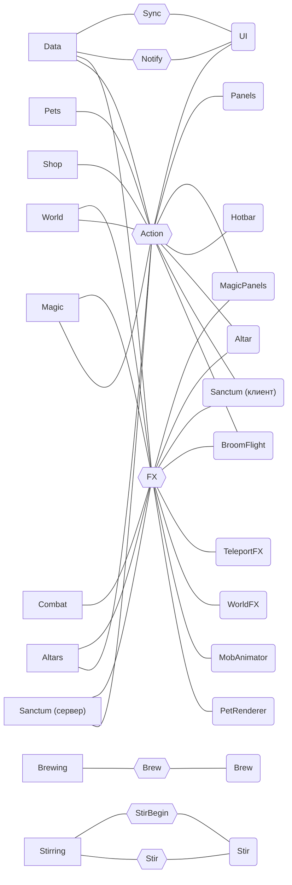

# MA 01 — Карта плейса

Связано: [[MA 00 - Обзор]]

![[MA карта мира.svg]]

Полная карта плейса: каждая заметка — один скрипт, ремоут, место в мире или биом. Связи — **настоящие связи из кода** (снимок 2026-11-19, place v87): кто кого подключает через `require`, кто какой ремоут использует, какие действия Action кто обрабатывает и вызывает, какой код и какой билдер работают с каким местом мира, соседи по дороге. Каждая папка — отдельный кластер галактики в Vault Cosmos. Сгенерировано скриптом mamap.mjs.

## Сеть: кто с кем говорит

## Сервер (12)
[[MA Altars]] · [[MA Brewing]] · [[MA Combat]] · [[MA Data]] · [[MA Magic]] · [[MA Main]] · [[MA Nodes]] · [[MA Pets]] · [[MA Sanctum (сервер)]] · [[MA Shop]] · [[MA Stirring]] · [[MA World]]

## Общие данные (16)
[[MA AltarGame]] · [[MA Biomes]] · [[MA BrewLogic]] · [[MA Brooms]] · [[MA Config]] · [[MA Creatures]] · [[MA Ingredients]] · [[MA PetInfo]] · [[MA PetVariants]] · [[MA Quests]] · [[MA Realms]] · [[MA Rebirth]] · [[MA Recipes]] · [[MA Sanctum (общий)]] · [[MA Stats]] · [[MA StirConfig]]

## Общие модели (6)
[[MA BroomModels]] · [[MA CreatureRig]] · [[MA IngredientModels]] · [[MA MobModels]] · [[MA MobModelsHQ]] · [[MA PetModels]]

## Клиент UI (7)
[[MA Art]] · [[MA ClientMain]] · [[MA Hotbar]] · [[MA HUD]] · [[MA MagicPanels]] · [[MA Panels]] · [[MA UI]]

## Клиент механики (7)
[[MA Altar]] · [[MA Brew]] · [[MA BrewSounds]] · [[MA BroomFlight]] · [[MA Sanctum (клиент)]] · [[MA Stir]] · [[MA TeleportFX]]

## Клиент мир (8)
[[MA Ambient]] · [[MA CharacterJuice]] · [[MA Effects]] · [[MA MobAnimator]] · [[MA MobSounds]] · [[MA PetRenderer]] · [[MA SanctumRoam]] · [[MA WorldFX]]

## Инструменты (3)
[[MA SanctumStageBuilder]] · [[MA WorldBuilder]] · [[MA WorldBuilder_OldIslands]]

## Ремоуты (7)
[[MA ремоут Action]] · [[MA ремоут Brew]] · [[MA ремоут FX]] · [[MA ремоут Notify]] · [[MA ремоут Stir]] · [[MA ремоут StirBegin]] · [[MA ремоут Sync]]

## Локации (14)
[[MA локация Алтари хаба]] · [[MA локация Ворота биомов]] · [[MA локация Книги и лекторны]] · [[MA локация Котлы]] · [[MA локация Площадь спавна]] · [[MA локация Святилище 1]] · [[MA локация Святилище 2]] · [[MA локация Святилище 3]] · [[MA локация Святилище 4]] · [[MA локация Святилище 5]] · [[MA локация Старые острова]] · [[MA локация Сцены Stage]] · [[MA локация Точки ингредиентов]] · [[MA локация Точки мобов]]

## Биомы (30)
[[MA биом 01 Whisperwood]] · [[MA биом 02 Frostveil Tundra]] · [[MA биом 03 Cinderpeak]] · [[MA биом 04 Sporehaven]] · [[MA биом 05 Mirefen Bog]] · [[MA биом 06 Glimmerdeep Caverns]] · [[MA биом 07 Sunscorch Dunes]] · [[MA биом 08 Coral Cove]] · [[MA биом 09 Stormspire Peaks]] · [[MA биом 10 Sugarplum Hollow]] · [[MA биом 11 Cogwork Bastion]] · [[MA биом 12 Sakura Vale]] · [[MA биом 13 Gravemoor]] · [[MA биом 14 Amber Savanna]] · [[MA биом 15 Abyssal Trench]] · [[MA биом 16 Titan Jungle]] · [[MA биом 17 Mirror Flats]] · [[MA биом 18 Autumn Emberwood]] · [[MA биом 19 Bone Wastes]] · [[MA биом 20 Golden Hive]] · [[MA биом 21 Lunar Garden]] · [[MA биом 22 Rustheap Yard]] · [[MA биом 23 Inkwell Marsh]] · [[MA биом 24 Cloudtop Causeway]] · [[MA биом 25 Obsidian Citadel]] · [[MA биом 26 Prism Glacier]] · [[MA биом 27 Dreamland Meadow]] · [[MA биом 28 Void Rift]] · [[MA биом 29 Solar Forge]] · [[MA биом 30 Starfall Sanctum]]
