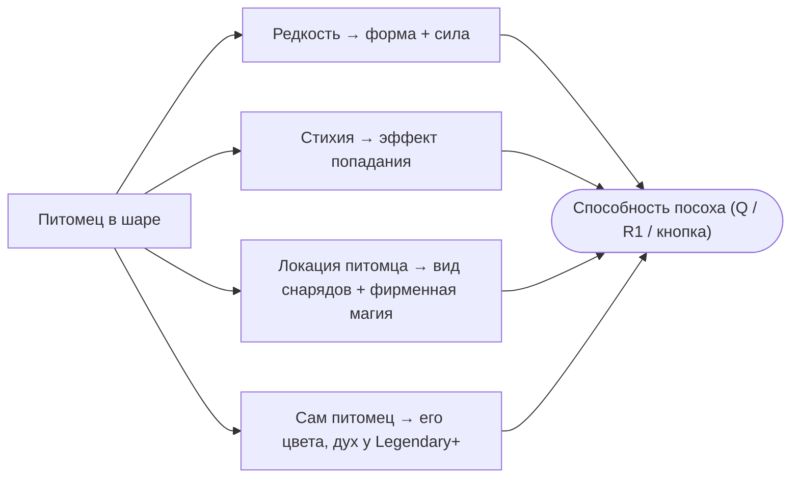

# MA 03 — Посохи волшебника

Связано: [[MA 00 - Обзор]] · [[MA 01 - Карта плейса]]

Посох работает **только** с питомцем, запечатанным в его шаре. Питомец уходит из отряда (его нельзя экипировать, поставить в Святилище или отпустить, пока он в посохе) и определяет способность посоха. Снимок из плейса 2026-11-20 (place v177).

Код: данные [[MA Staffs]] · сервер [[MA Staffs (сервис)]] · клиент [[MA Staffs (клиент)]] · анимации [[MA StaffAnim]] · эффекты [[MA StaffFX]]

## Откуда берётся способность

## 6 посохов
| Посох | Цена | Нужно Mastery | Урон | КД способностей |
|---|---|---|---|---|
| Apprentice Staff | бесплатно | 1 | ×1 | — |
| Thornroot Staff | 15K | 8 | ×1.6 | −5 % |
| Crystal Spire | 250K | 16 | ×2.6 | −10 % |
| Ember Scepter | 3M | 25 | ×4.2 | −15 % |
| Astral Crescent | 50M | 40 | ×7 | −20 % |
| Void Monarch | 2B | 64 | ×12 | −25 % |

Уровень посоха 1–15 растёт от убийств (опыт за убийство = 8 + 2 × номер биома, босс ×12); урон ×1.13 за уровень (15 ур. = ×5.5). Питомец в посохе тоже получает опыт за убийства.

**Болт** (ЛКМ / CAST / R2): ×0.85, КД 0.5 с, дальность 70. Удержание ≥ 0.7 с — заряженный болт ×2.2 с взрывом 6 студов. Пока держишь — стоишь на месте и целишься.

## Формы по редкости
| Редкость | Форма | Что делает |
|---|---|---|
| Обычный | Volley | залп: 3 самонаводящихся снаряда в ближайших врагов (×1.3 урона болта каждый, дальность 50, КД 6 с) |
| Необычный | Burst | взрыв: шар летит в цель и взрывается, задевая всех в радиусе 11 (×3.2, дальность 60, КД 8 с) |
| Редкий | Chain | цепь: луч прыгает по 5 врагам, прыжок до 22 студов, −12 % урона за прыжок (×3, КД 9 с) |
| Эпический | Nova | нова: удар посохом о землю, кольцо бьёт всех в радиусе 20 вокруг тебя (×4.5, КД 11 с) |
| Легендарный | Spirit | дух: гигантский дух этого питомца пробегает 48 студов вперёд по прицелу полосой шириной 9 и бьёт каждого на пути (×7, КД 13 с) |
| Мифический | Cataclysm | фирменная магия локации питомца в точке прицела (10 ударов ×3.2 за 2.2 с, КД 15 с) |
| Секретный | Ascension | ты взлетаешь с духом питомца, фирменная магия вокруг тебя (14 ударов ×2.6 за 2.8 с, КД 20 с) |

Название способности: Common–Epic = «слово стихии + форма» (Bloom Volley, Frost Nova…), Legendary = «<питомец> Spirit», Mythical = имя фирменной магии, Secret = «<магия> Ascendant».

## Эффект по стихии
| Стихия | Слово | Эффект каждого попадания |
|---|---|---|
| Природа (Nature) | Bloom | каждое попадание немного лечит тебя |
| Лёд (Frost) | Frost | каждое попадание замедляет врага |
| Огонь (Fire) | Flame | каждое попадание поджигает врага |
| Яд (Toxic) | Venom | каждое попадание отравляет врага |
| Гроза (Storm) | Thunder | каждое попадание бьёт разрядом соседних врагов |
| Земля (Earth) | Stone | каждое попадание даёт тебе щит |
| Тень (Shadow) | Shade | каждое попадание сильнее бьёт по раненым врагам |
| Звёзды (Celestial) | Star | попадания чаще критуют |

## Типы фирменной магии
| Тип | Как играет |
|---|---|
| `rain` / `erupt` | 10 (14) ударов радиусом 6, ~60 % прямо во врагов |
| `beam` | то же, но удары уже — радиус 5 |
| `swarm` | то же, самые узкие удары — радиус 4 |
| `wave` | стена 16 студов катится 54 студа вперёд, каждый враг получает 1 удар ×7.0 (×5.7) |
| `vortex` | воронка 13.5 (18) студов, 10 (14) тиков по всем внутри ×2.6 (×2.1) + замедление |
| `quake` | 4 топота радиусом 12, ×8.3 (×6.8) каждый |

В скобках — секретная версия (Ascension).

## Фирменная магия каждой локации
| # | Локация | Магия | Тип | Мифический | Секретный |
|---|---|---|---|---|---|
| 1 | [[MA биом 01 Whisperwood]] | **Thornwake** — кольцо терновых лоз | `erupt` | Moonlight Kitsune, Sylph Dragonet | Moonpetal Kirin |
| 2 | [[MA биом 02 Frostveil Tundra]] | **Glacial Spikes** — зазубренные ледяные шипы | `erupt` | Aurora Wyrm | Everfrost Phoenix |
| 3 | [[MA биом 03 Cinderpeak]] | **Meteor Rain** — горящие метеоры | `rain` | Sunforged Titan | Hellbriar Hydra, Prismatic Alchimera |
| 4 | [[MA биом 04 Sporehaven]] | **Sporecloud** — кружащееся облако спор | `vortex` | Sporeveil Dragon | Mycelord |
| 5 | [[MA биом 05 Mirefen Bog]] | **Bog Geysers** — булькающие грязевые гейзеры | `erupt` | Miasma Hydra | Plaguebloom Queen |
| 6 | [[MA биом 06 Glimmerdeep Caverns]] | **Crystal Lances** — дождь хрустальных копий | `rain` | Diamond Wyrm | Facet Seraph |
| 7 | [[MA биом 07 Sunscorch Dunes]] | **Desert Cyclone** — ревущий песчаный смерч | `vortex` | Sandstorm Djinn | Solar Pharaoh |
| 8 | [[MA биом 08 Coral Cove]] | **Tidal Crash** — обрушивающаяся приливная волна | `wave` | Maelstrom Serpent | Abyssal Siren |
| 9 | [[MA биом 09 Stormspire Peaks]] | **Skyfall Bolts** — удары молний | `beam` | Tempest Dragon | Skyfather Eagle |
| 10 | [[MA биом 10 Sugarplum Hollow]] | **Sugar Bombs** — взрывающиеся конфеты | `rain` | Sherbet Dragon | Sugarplum Fairy Queen |
| 11 | [[MA биом 11 Cogwork Bastion]] | **Gear Grinder** — катящиеся латунные шестерни | `wave` | Chrono Drake | Grand Automaton |
| 12 | [[MA биом 12 Sakura Vale]] | **Petal Tempest** — лепестки-лезвия | `swarm` | Spirit Koi Dragon | Thousand-Petal Kirin |
| 13 | [[MA биом 13 Gravemoor]] | **Grasping Dead** — призрачные руки | `erupt` | Wraith Dragon | Lich Lord |
| 14 | [[MA биом 14 Amber Savanna]] | **Amber Pillars** — столбы расплавленного янтаря | `beam` | Sunmane Griffin | Golden Behemoth |
| 15 | [[MA биом 15 Abyssal Trench]] | **Abyssal Maelstrom** — давящий глубинный водоворот | `vortex` | Trench Leviathan | Void Kraken |
| 16 | [[MA биом 16 Titan Jungle]] | **Titan Stomp** — титанические топоты | `quake` | Primal Quetzal | Elder Titanosaur |
| 17 | [[MA биом 17 Mirror Flats]] | **Mirror Lances** — зеркальные копья света | `beam` | Spectrum Wyrm | Infinite Reflection |
| 18 | [[MA биом 18 Autumn Emberwood]] | **Maple Firestorm** — огненный вихрь из горящих кленовых листьев | `vortex` | Harvest Dragon | Headless Harvester |
| 19 | [[MA биом 19 Bone Wastes]] | **Bone Spears** — костяные копья | `erupt` | Bone Wyvern | Fossil Emperor |
| 20 | [[MA биом 20 Golden Hive]] | **Hive Swarm** — злой пчелиный рой | `swarm` | Royal Queen Bee | Golden Hive Empress |
| 21 | [[MA биом 21 Lunar Garden]] | **Moonbeams** — падающие лунные лучи | `beam` | Lunar Dragon | Eclipse Empress |
| 22 | [[MA биом 22 Rustheap Yard]] | **Scrap Magnet** — вращающийся магнит из металлолома | `vortex` | Reactor Wyrm | Scrap Leviathan |
| 23 | [[MA биом 23 Inkwell Marsh]] | **Ink Tentacles** — чернильные щупальца | `erupt` | Calligraphy Dragon | The Unwritten |
| 24 | [[MA биом 24 Cloudtop Causeway]] | **Thunderhead** — трескучая грозовая туча | `rain` | Zephyr Dragon | Aurora Pegasus |
| 25 | [[MA биом 25 Obsidian Citadel]] | **Obsidian Spires** — обсидиановые шпили | `erupt` | Nightfire Dragon | Shadow Emperor |
| 26 | [[MA биом 26 Prism Glacier]] | **Prism Lasers** — радужные призменные лазеры | `beam` | Prism Phoenix | Rainbow Mammoth King |
| 27 | [[MA биом 27 Dreamland Meadow]] | **Dream Bubbles** — лопающиеся пузыри снов | `swarm` | Reverie Dragon | Sandman Sovereign |
| 28 | [[MA биом 28 Void Rift]] | **Event Horizon** — чёрная дыра | `vortex` | Singularity Dragon | The Hollow One |
| 29 | [[MA биом 29 Solar Forge]] | **Solar Flare** — пылающие солнечные вспышки | `beam` | Supernova Dragon | Sun Emperor |
| 30 | [[MA биом 30 Starfall Sanctum]] | **Starfall** — падающие звёзды | `rain` | Cosmos Dragon | The First Familiar |

Подробно по каждому питомцу — в разделе «Посохи» заметки каждой локации.

<!-- staffdesign:start -->
## Дизайн: чем реже питомец и дальше локация — тем круче

> [!info] Статус: дизайн, в игре пока нет. Подробные карточки каждого питомца — в заметках локаций.

### Круги локаций
| Круг | Локации | Что даёт |
|---|---|---|
| I — Круг ученика | [[MA биом 01 Whisperwood\|Whisperwood]], [[MA биом 02 Frostveil Tundra\|Frostveil Tundra]], [[MA биом 03 Cinderpeak\|Cinderpeak]], [[MA биом 04 Sporehaven\|Sporehaven]], [[MA биом 05 Mirefen Bog\|Mirefen Bog]], [[MA биом 06 Glimmerdeep Caverns\|Glimmerdeep Caverns]] | базово 1 слой у каждой способности |
| II — Круг подмастерья | [[MA биом 07 Sunscorch Dunes\|Sunscorch Dunes]], [[MA биом 08 Coral Cove\|Coral Cove]], [[MA биом 09 Stormspire Peaks\|Stormspire Peaks]], [[MA биом 10 Sugarplum Hollow\|Sugarplum Hollow]], [[MA биом 11 Cogwork Bastion\|Cogwork Bastion]], [[MA биом 12 Sakura Vale\|Sakura Vale]] | базово 2 слоя у каждой способности |
| III — Круг мага | [[MA биом 13 Gravemoor\|Gravemoor]], [[MA биом 14 Amber Savanna\|Amber Savanna]], [[MA биом 15 Abyssal Trench\|Abyssal Trench]], [[MA биом 16 Titan Jungle\|Titan Jungle]], [[MA биом 17 Mirror Flats\|Mirror Flats]], [[MA биом 18 Autumn Emberwood\|Autumn Emberwood]] | базово 3 слоя у каждой способности |
| IV — Круг архимага | [[MA биом 19 Bone Wastes\|Bone Wastes]], [[MA биом 20 Golden Hive\|Golden Hive]], [[MA биом 21 Lunar Garden\|Lunar Garden]], [[MA биом 22 Rustheap Yard\|Rustheap Yard]], [[MA биом 23 Inkwell Marsh\|Inkwell Marsh]], [[MA биом 24 Cloudtop Causeway\|Cloudtop Causeway]] | базово 4 слоя у каждой способности |
| V — Круг легенды | [[MA биом 25 Obsidian Citadel\|Obsidian Citadel]], [[MA биом 26 Prism Glacier\|Prism Glacier]], [[MA биом 27 Dreamland Meadow\|Dreamland Meadow]], [[MA биом 28 Void Rift\|Void Rift]], [[MA биом 29 Solar Forge\|Solar Forge]], [[MA биом 30 Starfall Sanctum\|Starfall Sanctum]] | базово 5 слоёв у каждой способности |

### Слои способности
| # | Слой | Что делает |
|---|---|---|
| 1 | Стихия | эффект стихии питомца на каждом попадании (горение, яд, замедление, лечение, щит, разряд, казнь, крит) |
| 2 | Эффект локации | фирменный статус локации: Оплетение, Обморожение, Расплав, Мираж, Поднятые, Распад, Созвездие… |
| 3 | След | зона на земле 2–4 с: лужа лавы, каток, споровый туман, лунная дорожка… |
| 4 | Отклик | вторичная реакция: раскол снаряда, осколки, рой из убитых, малые чёрные дыры… |
| 5 | Финал | завершающее событие локации: дерево, извержение, циферблат, комета, малое солнце… |

Слоёв = круг + бонус редкости (Обычный/Необычный +0, Редкий/Эпический +1, Легендарный/Мифический +2, Секретный +3), максимум 5. Обычный питомец из Whisperwood — 1 слой; секретный из Starfall Sanctum — все 5 слоёв, 4 фазы и сверх-финал.

### Рост чисел по локации (i = 1…30)
| Форма | Формула | Локация 1 → 30 |
|---|---|---|
| Залп | 3 + ⌊(i−1)/5⌋ снарядов | 3 → 8 |
| Взрыв | радиус 11 + 0.4(i−1) | 11 → 22.6 |
| Цепь | 5 + ⌊(i−1)/4⌋ целей | 5 → 12 |
| Нова | радиус 20 + 0.6(i−1), колец 1 + ⌊(i−1)/10⌋ | 20 / 1 → 37.4 / 3 |
| Дух | пробег 48 + 2(i−1) | 48 → 106 |
| Катаклизм | 10 + ⌊(i−1)/2⌋ ударов, радиус 18 + 0.5(i−1) | 10 / 18 → 24 / 32.5 |
| Вознесение | 14 + (i−1) ударов, радиус 24 + 0.6(i−1), фаз 2–4 | 14 / 24 / 2 → 43 / 41.4 / 4 |

Сила эффекта локации: ×(0.5 + 0.17·(ранг редкости − 1)) × (1 + 0.02·(i − 1)) — от ×0.5 у обычного в первой локации до ×2.4 у секретного в последней; проценты ограничены двойным базовым значением.

### Масштаб эффектов по редкости
| Редкость | Как выглядит и звучит |
|---|---|
| Обычный | лёгкий: снаряды со шлейфом, маленькая вспышка на попадании, один звук, без тряски камеры |
| Необычный | ударное кольцо на земле, всплеск частиц, лёгкая тряска |
| Редкий | светящийся луч и дуги между целями, пульс света на каждом прыжке, звук нарастает с каждым прыжком |
| Эпический | за 0.4 с до удара на земле загорается руна-печать локации, пыль и обломки взлетают, свет заливает круг, средняя тряска |
| Легендарный | призрак питомца в полный рост с его анимацией бега, рёв/крик питомца, яркий свет, след духа на земле 2 с |
| Мифический | небо над полем окрашивается в цвета локации (цветокоррекция 2 с), в воздухе горит огромная руна, тяжёлая тряска, музыкальный стингер в тональности локации |
| Секретный | игрок взлетает в ореоле, перед финалом время визуально замедляется на 0.3 с, название способности крупно по центру экрана, все эффекты в 1.5 раза крупнее, финальный взрыв на весь экран |

### Стихия в больших способностях (Легендарный и выше)
| Стихия | Обычный эффект | Дополнительно в больших способностях |
|---|---|---|
| Природа | каждое попадание лечит игрока на 2 % макс. здоровья — от врага к игроку летят зелёные искры | каждые 3 попадания из земли вырастает цветок-лекарь: 2 с лечит игрока на 5 % здоровья |
| Лёд | замедляет врага на 45 % на 2.5 с — он покрывается инеем и двигается рывками | враг, получивший 3 удара, вмерзает в лёд на 1 с |
| Огонь | поджигает: ещё +60 % урона за 3 с (3 тика по 20 %) — на враге пляшет пламя | каждый удар оставляет огненную лужу на 2 с |
| Яд | отравляет: ещё +75 % урона за 5 с (5 тиков по 15 %) — зелёные пузыри и капли яда | враг, умерший под ядом, лопается ядовитым облаком (радиус 6) |
| Гроза | разряд перескакивает на одного соседа в 14 студах (35 % урона) — видна ветвистая дуга | каждый удар пускает дополнительную дугу в соседа |
| Земля | щит на 3 с: −30 % получаемого урона — вокруг игрока каменная оболочка | каждый удар добавляет слой щита (до 3 слоёв, −10 % урона каждый) |
| Тень | +60 % урона врагам ниже половины здоровья — на них вспыхивает тёмная «казнь» | враги ниже 15 % здоровья добиваются мгновенно тёмной вспышкой |
| Звёзды | +25 % шанса крита — на каждом крите вспыхивает звезда | каждый крит вызывает дополнительную звезду с неба (×1 урона болта) |

### Эффект локации — все 30
| # | Локация | Эффект | След | Финал |
|---|---|---|---|---|
| 1 | [[MA биом 01 Whisperwood\|Whisperwood]] | **Оплетение** — лозы обвивают ноги врага — он обездвижен на 0.8 с | терновая поляна: колючки ранят каждого врага внутри (×0.3 урона болта в секунду) | в центре за секунду вырастает Старое дерево и хлещет ветвями по кругу |
| 2 | [[MA биом 02 Frostveil Tundra\|Frostveil Tundra]] | **Обморожение** — на враге копятся стаки холода; 3 стака — он вмерзает в глыбу льда на 0.8 с | ледяной каток: враги скользят и замедлены на 30 % | пурга накрывает экран, и в центр падает огромная глыба льда |
| 3 | [[MA биом 03 Cinderpeak\|Cinderpeak]] | **Расплав** — враг раскаляется: огонь по нему жжёт на 26 % сильнее 0.9 с | лавовая лужа: жжёт всех, кто в неё ступил | в центре бьёт столб лавы, а потом сыплется горячий пепел |
| 4 | [[MA биом 04 Sporehaven\|Sporehaven]] | **Заражение** — споры садятся на врага; если он умрёт за 0.9 с, споры перескакивают на 2 ближайших | споровый туман: враги внутри бьют на 20 % слабее | вырастает гигантский гриб и выбрасывает огромное облако спор |
| 5 | [[MA биом 05 Mirefen Bog\|Mirefen Bog]] | **Трясина** — враг вязнет: замедлен и его тянет к центру удара 1 с | болотная жижа: замедление 40 % | всё болото вскипает, из центра бьёт огромный гейзер |
| 6 | [[MA биом 06 Glimmerdeep Caverns\|Glimmerdeep Caverns]] | **Резонанс** — на враге вырастает кристалл; следующий удар разбивает его (+44 % урона) | кристальное поле: острые кристаллы ранят наступивших | в центре вырастает огромная друза и лопается вспышкой света |
| 7 | [[MA биом 07 Sunscorch Dunes\|Sunscorch Dunes]] | **Мираж** — рядом появляется мираж-двойник игрока; враги отвлекаются на него 2.1 с | зыбучий песок: затягивает врагов к центру | песчаная буря закрывает экран, древний обелиск бьёт солнечным лучом |
| 8 | [[MA биом 08 Coral Cove\|Coral Cove]] | **Отлив** — врага отбрасывает назад, его атака сбивается (1.1 с) | лужи морской воды: враги скользят | огромная волна с кораллами накрывает поле |
| 9 | [[MA биом 09 Stormspire Peaks\|Stormspire Peaks]] | **Заряд** — на враге копится заряд; 5 стаков — в него бьёт молния (×3.5 урона болта) | наэлектризованная земля: каждые 0.5 с бьёт искра | в центр с неба бьёт громовой столб |
| 10 | [[MA биом 10 Sugarplum Hollow\|Sugarplum Hollow]] | **Сахарная кома** — враг засыпает на 1.2 с (над ним «Zzz»), следующий удар по нему ×1.5 | липкая карамель: враги прилипают | с неба падает торт-бомба |
| 11 | [[MA биом 11 Cogwork Bastion\|Cogwork Bastion]] | **Заводной механизм** — на месте удара встаёт мини-турель-шестерня и стреляет 3.8 с | вращающиеся шестерни в земле: перемалывают врагов | на земле появляется циферблат, стрелка проходит полный круг и бьёт всех |
| 12 | [[MA биом 12 Sakura Vale\|Sakura Vale]] | **Лепестковая метка** — на враге метка-лепесток; удары по нему критуют на 25 % чаще | ковёр лепестков: лечит игрока, пока он стоит на нём | призрачная сакура вспыхивает и роняет все лепестки разом |
| 13 | [[MA биом 13 Gravemoor\|Gravemoor]] | **Поднятые** — убитый враг встаёт призраком-союзником и сражается 4.1 с | могильный туман: враги внутри слабеют | открывается склеп и вылетает рой духов |
| 14 | [[MA биом 14 Amber Savanna\|Amber Savanna]] | **Янтарная ловушка** — враг застывает в янтаре на 1.4 с | тёплый янтарь на земле: враги вязнут | солнце саванны вспыхивает, в центре поднимается столб янтаря |
| 15 | [[MA биом 15 Abyssal Trench\|Abyssal Trench]] | **Давление** — глубина давит на врага: он получает на 19 % больше урона (стаки) | тёмная вода: замедление | из глубины открывается огромный глаз и бьёт лучом |
| 16 | [[MA биом 16 Titan Jungle\|Titan Jungle]] | **Сотрясение** — враг оглушён на 1.5 с | трещины в земле: бьют при каждом топоте | сверху опускается огромная нога титана |
| 17 | [[MA биом 17 Mirror Flats\|Mirror Flats]] | **Отражение** — с шансом 33 % способность повторяется зеркальной копией | зеркальная гладь: отражает снаряды обратно во врагов | над полем встаёт зеркальный купол, все лучи сходятся в центр |
| 18 | [[MA биом 18 Autumn Emberwood\|Autumn Emberwood]] | **Листопад** — вокруг игрока 4.9 с кружат горящие листья и бьют подошедших | горящие листья на земле | в центре вспыхивает огненный клён |
| 19 | [[MA биом 19 Bone Wastes\|Bone Wastes]] | **Кость за кость** — игрок высасывает 7 % нанесённого урона в здоровье | костяное поле: шипы из земли | из земли поднимается гигантская челюсть и смыкается |
| 20 | [[MA биом 20 Golden Hive\|Golden Hive]] | **Улей** — появляются пчёлы и жалят врагов 5.3 с | медовая лужа: враги вязнут | падают огромные соты и выпускают рой |
| 21 | [[MA биом 21 Lunar Garden\|Lunar Garden]] | **Фазы луны** — урон меняется по кругу от новолуния ×0.8 до полнолуния ×2.3 | лунная дорожка: ускоряет игрока | полная луна опускается и взрывается |
| 22 | [[MA биом 22 Rustheap Yard\|Rustheap Yard]] | **Магнетизм** — врагов стягивает в кучу к точке удара за 1.9 с | ржавая свалка: металлические шипы | сверху падает огромный пресс |
| 23 | [[MA биом 23 Inkwell Marsh\|Inkwell Marsh]] | **Чернильная клякса** — враг ослеплён: 73 % его атак мимо 1.9 с | чернильное пятно: замедляет | гигантское перо пишет руну на земле, и руна взрывается |
| 24 | [[MA биом 24 Cloudtop Causeway\|Cloudtop Causeway]] | **Подъём** — врага подбрасывает в воздух на 2 с, он беспомощен | облако: враги внутри медленно падают | торнадо из облаков |
| 25 | [[MA биом 25 Obsidian Citadel\|Obsidian Citadel]] | **Закалка** — каждое убийство даёт игроку слой обсидиановой брони (до 5 слоёв, −8 % получаемого урона каждый) | раскалённый обсидиан: земля трескается алыми жилами и жжёт врагов | из земли за секунду вырастает обсидиановая крепость с башнями — и рушится внутрь, погребая врагов |
| 26 | [[MA биом 26 Prism Glacier\|Prism Glacier]] | **Преломление** — каждый удар распадается на 5 цветных лучей — у каждого своя стихия (огонь, лёд, яд, гроза, земля, тень, звёзды) | призменная наледь: каждый снаряд, пролетая над ней, раздваивается | в небе встаёт огромная ледяная призма, свет проходит сквозь неё и бьёт по полю радугой |
| 27 | [[MA биом 27 Dreamland Meadow\|Dreamland Meadow]] | **Сон** — враги засыпают на 2.2 с; первый удар по спящему наносит ×2 урона | облако снов: враг, простоявший в нём 1.5 с, засыпает | опускается огромная Луна-колыбель и качается — засыпают все враги на поле |
| 28 | [[MA биом 28 Void Rift\|Void Rift]] | **Распад** — враги ниже 19 % здоровья стираются из мира мгновенно (рассыпаются пикселями) | разлом пустоты: трещина в реальности затягивает врагов внутрь | пространство схлопывается в точку, экран на миг инвертирует цвета, затем всё возвращается ударной волной |
| 29 | [[MA биом 29 Solar Forge\|Solar Forge]] | **Перегрев** — попадания копят жар врага; полная шкала — солнечная вспышка (×9.5 урона болта всем в 10 студах) | раскалённая плавильня: земля светится белым и плавит врагов | в небе зажигается малое солнце и выжигает поле (экран засвечивается белым) |
| 30 | [[MA биом 30 Starfall Sanctum\|Starfall Sanctum]] | **Созвездие** — враги соединяются светящимися линиями в созвездие; 40 % урона по одному передаётся всем | звёздная пыль: враги внутри подсвечены и получают больше критов | с неба падает комета, ночное небо на миг становится видно даже днём |
<!-- staffdesign:end -->

## Не проверено
- Визуально эффекты и поза держания посоха ещё не осмотрены: 3D-рендер Studio падал во время сессии 2026-11-20.
- Плейс сохранён (v177), но не опубликован.
