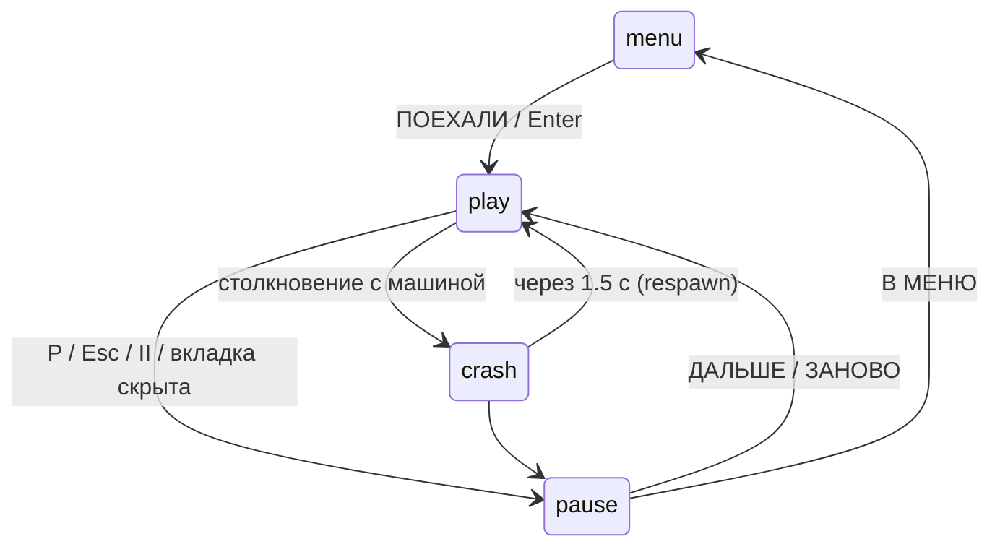

# Состояния игры
Часть [[MM 00 - Обзор]]. Переменная `state`: `menu | play | crash | pause`.

- **menu**: мотоцикл едет сам (автопилот, см. [[MM 05 - Физика мотоцикла]]), камера облетает его сбоку. Кристаллы собираются, но не засчитываются.
- **play**: управляет игрок, идёт счёт км.
- **crash**: инверсия экрана, слоу-мо 0.55 с, вибрация 120 мс; через 1.5 с `respawn()`: скорость 16 м/с, неуязвимость 2.6 с (мигание), машины рядом убираются. **Забег не заканчивается**: проигрыша нет, авария только отнимает время.
- **pause**: P/Esc, кнопка II, скрытие вкладки, «назад»/сворачивание на Android. Рекорд сохраняется при паузе, рестарте и выходе в меню: [[MM 15 - Сохранение]].

Откуда аварии: [[MM 09 - Трафик]]. Экраны: [[MM 14 - Интерфейс и язык]].
